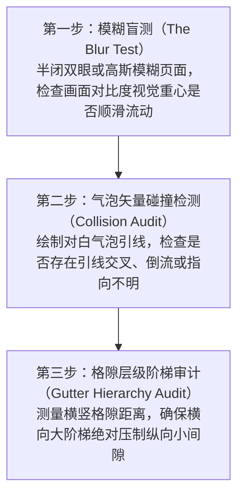

# comics-troubleshooting-and-flow-auditing

漫画分格排障与眼球轨迹流势审计（视觉死胡同、气泡交叉撞车与阅读顺序倒流修复流水线）。

## 核心法则与力学机制

### 1. 眼球轨迹流势审计三步法（Three-Step Flow Audit Pipeline）

---

### 2. 常见四大致命分格病灶排查清单

1. **视觉死胡同（Visual Dead End）**：
   - **症状**：读者的眼球顺着角色的视线或动作滑落到了画面的角落，但那里既没有下一个分格，也没有台词气泡，视线陷入绝境不知所措；
   - **手术刀**：调整角色朝向或将下一个分格的引人视觉元素放置在视线延伸线上，形成平滑中继跳板。
2. **气泡倒流交叉（Reverse Dialogue Crossing）**：
   - **症状**：在自左向右阅读的欧美漫画中，先说话的人被画在右边，后说话的人被画在左边，气泡在中央交叉；
   - **手术刀**：镜像翻转角色的站位构图，让发话者始终占据阅读流势的第一顺位。
3. **等距迷宫网格（Equidistant Maze）**：
   - **症状**：四格或六格的横竖格隙完全等宽，读者无法判断是“先横后竖”还是“先竖后横”；
   - **手术刀**：将行间距拉大至列间距的 3 倍，打破歧义。
4. **视觉噪点轰炸（Visual Noise Overload）**：
   - **症状**：画面每一个角落都画满了极度复杂的网点、排线和背景杂物，主体角色被背景彻底淹没；
   - **手术刀**：执行黑白明度分级（Values Flattening），角色主体用纯黑或高对比勾线，背景弱化为浅灰网点或负空间留白。

---

## 工业实操排障与自查反模式表

| 诊断指标 | 危险警报标志 | 外科手术纠正指标 |
| :--- | :--- | :--- |
| **首眼注意力停留点** | 翻开页面第一眼看的是一个无关紧要的路人或背景砖头 | 强化主格主体的明暗对比与饱和度，构建绝对的第一视觉磁石 |
| **读者阅读停顿率** | 读者在某一处停顿超过 0.5 秒寻找下一格位置 | 简化分格切割几何，消灭锐角三角形穿插，恢复标准阶梯流势 |
| **气泡引线长度** | 引线长达半个画面，穿过两三个角色的身体 | 移动气泡紧贴说话者头顶，引线长度严格控制在 10-20mm 之间 |
| **动作动势一致性** | 上一格角色向右挥刀，下一格受击者却向右倒下（违背牛顿第三定律） | 修正受击者倒地方向为向左飞出，保持屏幕动能矢量守恒 |
