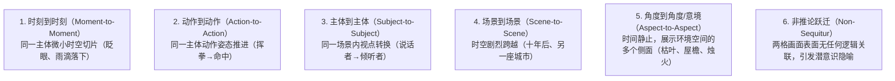

# gutter-closure-and-six-panel-transitions

格隙闭合心理学与六大分格跃迁力学（时刻到时刻、动作到动作、主体到主体、场景到场景、角度到角度与非推论跃迁）。

## 核心法则与力学机制

### 1. 格隙（The Gutter）与闭合（Closure）的本质
斯科特·麦克劳德指出：**漫画的魔法并不发生在画框内，而是发生在画框之间的格隙中！**
- 分格展示的是断续的静态瞬间，而读者的大脑基于格式塔心理学（Gestalt Psychology）中的“闭合”本能，在格隙中自发补全了消失的运动、声音与时间；
- 读者不是被动的消费者，而是漫画创作的**共谋者**与**合伙人**。

---

### 2. 六大分格跃迁（The Six Panel Transitions）力学图谱

### 3. 美漫与日漫跃迁谱系特征差异
- **欧美商业漫画（Marvel/DC）**：以 **动作到动作（Action-to-Action）** 和 **主体到主体（Subject-to-Subject）** 为绝对主导（占 70%-80%），叙事极其注重因果推进与效率，极少浪费篇幅；
- **日本漫画（Manga）**：保留动作与主体跃迁的同时，大量引入 **角度到角度（Aspect-to-Aspect）** 与 **时刻到时刻（Moment-to-Moment）**，通过微观静止与极慢切片，营造出浓烈的东方禅意、空间氛围与窒息般的心理悬疑。

---

## 工业实操排障与反模式

| 常见致命失误 | 缺陷诊断 | 工业标准重构法 |
| :--- | :--- | :--- |
| **全篇单一动作跃迁** | 通篇只有动作到动作，读者呼吸感窒息，缺乏环境沉浸感 | 在大场面战斗爆发前或激烈情绪转变处，插入 2-3 格“角度到角度”的环境渲染格 |
| **跃迁跨度过大失控** | 从格 A 到格 B 缺少必要桥梁，读者大脑无法完成合理闭合 | 检查因果链条，在中间补充一个承上启下的“主体到主体”或“动作中转”格 |
| **无意义非推论堆砌** | 强行插入毫无关联的画面故作高深，打断主线叙事流 | 确保每一个非推论分格与全剧的核心哲学论题或角色的潜意识精神意象紧密对位 |
