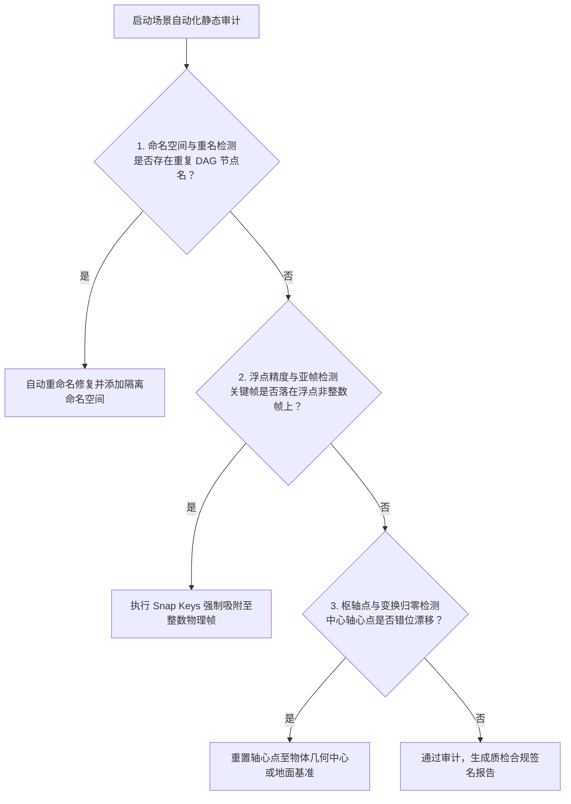

# pipeline-troubleshooting-and-asset-audit

数字动画管线排障与资产审计流水线（丢帧、浮点精度漂移、轴心点错位与场景健康度自愈）。

## 核心法则与工程机制

### 1. 数字动画场景健康度自动化审计流水线（Asset Health Audit Pipeline）

---

### 2. 三大核心生产灾难与外科手术急救法
1. **浮点亚帧漂移灾难（Sub-frame Key Drifting）**：
   - 动画师在缩放时间轴或更改帧率（如 24fps 改为 30fps）时，关键帧跑到了 `12.37` 帧；
   - 渲染农场以整数帧渲染时直接跳过极值，导致动画突然出现抽搐与瞬移；
   - **手术刀**：运行 `cmds.snapKey(timeMultiple=1.0)` 强制将全场景所有动画曲线关键帧吸附回最近的整数物理帧。
2. **欧拉角翻转死锁（Gimbal Lock / Euler Flip）**：
   - 旋转三轴中两个轴向重合，旋转曲线在两帧之间暴跳 360°；
   - **手术刀**：在 Graph Editor 中执行 `Curves -> Euler Filter` 自动化算法消除相位跳跃。
3. **未知插件与脏节点污染（Unknown Nodes Infection）**：
   - 场景中遗留上游失效插件节点（如旧版渲染器节点），导致无此插件的机器打开文件时报错阻断；
   - **手术刀**：运行 `cmds.delete(cmds.ls(type="unknown"))` 批量扫除全部未知节点。

---

## 工业实操排障与自查反模式表

| 诊断指标 | 危险警报标志 | 外科手术纠正指标 |
| :--- | :--- | :--- |
| **亚帧关键帧存在率** | 时间轴上红线不在整数刻度上，出现小数位 | 执行全场景强制吸附（Snap Keys），消除所有亚帧浮点 |
| **欧拉旋转暴跳** | 曲线在第 45 帧与 46 帧之间突变 180° 或 360° | 执行 Euler Filter 算法，重构连续旋转插值四元数 |
| **轴心点严重偏离** | 物体在画面中央，但轴心点飞在数米开外的虚空 | 执行 `Center Pivot` 或将轴心对齐至角色双脚地面接触中点 |
| **未知脏节点残留** | 打开文件弹窗提示缺少第三方专有插件 | 自动化脚本清理所有 `unknown` 节点，净化场景轻量化 |
