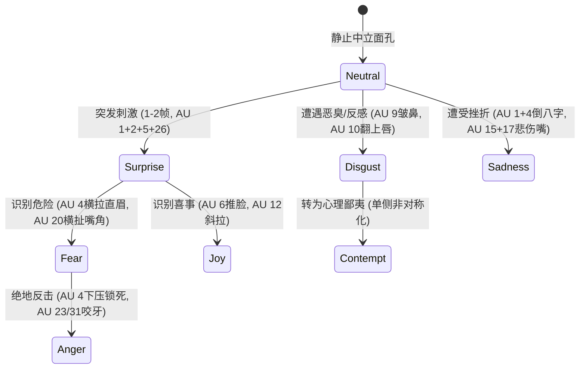

# 人类七大普适核心情绪与复合微表情 FACS 拓扑合成

## 1. 原理与情绪空间拓扑架构

人类跨文化、跨人种皆具备对七大普适情绪（Universal Facial Expressions）的本能识别与神经表达机制。在《Anatomy of Facial Expression》中，乌尔迪斯·扎林斯将达尔文的进化生物学、保罗·埃克曼的 FACS 动作编码系统与三维解剖学完美融合，确立了七大纯净情绪的基底向量空间。任何极其复杂的戏剧表演或复合微表情，本质上都是这七大基本情绪向量在不同强度（0.0 - 1.0）与时间线上的空间合成。

---

## 2. 七大普适核心情绪 FACS 参数规范全谱

### 七大情绪全解剖参数映射表

| 核心情绪 (Emotion) | 上半脸核心肌群 (Upper Face AU) | 中面部核心肌群 (Midface AU) | 下半脸与下颌核心肌群 (Lower Face AU) | 典型视觉特征与光影形变 |
| :--- | :--- | :--- | :--- | :--- |
| **1. 喜悦 (Joy)** | **AU 6** (眶部收缩推高脸颊+鱼尾纹) | 鼻唇沟上端深化 | **AU 12** (大颧肌斜拉) + **AU 25** (开唇) | 双眼眯成弯月，面颊苹果肌隆起高光，白牙微露 |
| **2. 悲伤 (Sadness)** | **AU 1** (内眉高抬) + **AU 4** (皱眉内拉) | 泪沟凹陷加深 | **AU 15** (降口角) + **AU 17** (颏肌推高橘皮下巴) | 倒八字八字眉，眉心三角隆起，倒“U”形嘴角 |
| **3. 狂怒 (Anger)** | **AU 4** (双眉死锁压低) + **AU 5** (暴睁露白) + **AU 7** (下睑紧绷) | **AU 38** (鼻孔扩张) | **AU 23/24** (紧抿唇) 或 **AU 10+16+26** (暴吼露齿) + **AU 31** (咬牙) | 眉心坚硬垂直双川字纹，眼神锐利锁死，咬肌暴胀 |
| **4. 恐惧 (Fear)** | **AU 1+2** (双眉高挑) + **AU 4** (内拉拉平成直线) + **AU 5** (极度暴睁) | 鼻翼紧绷 | **AU 20** (笑肌水平横向撕扯) + **AU 25/26** (扁平大张) | 双眉紧绷平直，巩膜全露，嘴唇扁平横向拉伸变薄 |
| **5. 惊讶 (Surprise)** | **AU 1+2** (双眉整体平滑圆拱高抬) + **AU 5** (放松大睁) | 中面部平滑拉长 | **AU 26** (下颌重力自然下垂松弛大张，双唇无横向张力) | 眉毛如高拱彩虹，下巴脱节般松弛下垂，口裂呈椭圆形 |
| **6. 厌恶 (Disgust)** | **AU 4** (轻度下压) | **AU 9** (上唇鼻翼提肌强力皱鼻) + **AU 10** (提上唇露上牙) | **AU 15** (嘴角下沉) + **AU 17** (下巴微推) | 鼻梁密集横纹，上唇翻起，鼻唇沟上端吊起，舌尖微抵 |
| **7. 蔑视 (Contempt)** | 上半脸基本中立，眼睑轻微收窄 (AU 7) | 单侧鼻唇沟微深 | **单侧 AU 12** (单侧嘴角微翘) 或 **单侧 AU 14** (单侧酒窝收紧) | 显著单侧不对称，微抬下巴，眼神斜睨，传达优越冷感 |

---

## 3. 情绪复合与状态机转换动力学

- **复合情绪矩阵计算公式**：
  设目标复杂情绪向量为 $\vec{E}_{\text{target}}$，可由基础情绪按权重 $\alpha_i$ 线性或非线性叠加：
  $$\vec{E}_{\text{target}} = \sum_{k=1}^{7} \alpha_k \vec{E}_k, \quad \text{s.t.} \ \sum |\alpha_k| \le 1.5$$
  - **惊恐狂怒（Terrified Rage）**：$\vec{E} = 0.6 \text{Fear} + 0.8 \text{Anger}$（AU 1+4 眉毛拉平微锁，AU 5 眼眶暴睁，AU 20+26 嘴唇横扯大张，AU 31 咬肌反复抽动）。
  - **悲喜交加（Bittersweet Joy）**：$\vec{E} = 0.7 \text{Joy} + 0.5 \text{Sadness}$（AU 6+12 面颊高耸微笑，但内侧眉毛顽固保持 AU 1+4 悲伤倒八字，眼角含泪）。

---

## 4. 工业级执行步骤与落地流水线

1. **第 1 步：全参数表情姿态预设库构建（Pose Library Setup）**
   - 在 Studio 资产管线中，针对绑定的 50+ 个核心 AU 通道，精确存储七大纯净核心表情的 Pose Preset（`joy_100`, `sadness_100`, `anger_100` 等）；
   - 每个预设的各通道权重严格遵照上表解剖规范配置。
2. **第 2 步：复合表情权重融合与极限保护（Composite Clamping）**
   - 编写 Python 权重融合脚本，当同时混合多种表情（如愤怒 + 恐惧）时，对冲突通道（如 AU 1 向上 vs AU 4 向下）执行力学矢量加减与极值钳制（Clamp [0.0, 1.0]），避免网格撕裂。
3. **第 3 步：时间线微表情过渡曲线调制（Sub-second Timeline Polishing）**
   - 快速惊吓（Surprise）只持续 2-4 帧；
   - 随后的恐惧（Fear）在 5-8 帧内达到峰值；
   - 狂怒（Anger）与悲伤（Sadness）则具有更长的攀升时间（12-24 帧）与缓慢的心理平复余波（30-60 帧）。

---

## 5. 典型案例与对比

- **惊恐与惊讶的生理反差排障案例**：
  - **角色推开门看到爆炸（惊讶转恐惧）**：
    - Frame 0-3：惊讶完全激活（高拱圆眉 AU 1+2，松弛下垂椭圆嘴 AU 26）；
    - Frame 4-8：大脑识别致命威胁，AU 4 突然介入将高拱圆眉向内狠狠拉直成水平刀片，笑肌 AU 20 爆发性向两侧撕扯嘴裂，松弛椭圆瞬间转变为紧绷的扁平横口，喉结剧烈吞咽。观众在 8 帧之内清晰感知到角色的心理认知转变。

---

## 6. 常见反模式与纠偏排障

- **反模式 1：恐惧与惊讶混淆（Fear-Surprise Mixup）**
  - *现象*：角色遭遇生死绝境时，脸上顶着两道滑稽的高拱挑眉和圆形金鱼嘴。
  - *纠偏*：立即加入 AU 4 将眉毛拉直拉平，加入 AU 20 将嘴角向后横拉，消除松弛圆嘴。
- **反模式 2：蔑视表情双面对称（Symmetric Contempt Absurdity）**
  - *现象*：蔑视表情做了左右两侧完全对称的提口角。
  - *纠偏*：蔑视在人类进化心理学中必须是不对称的（Unilateral）；将一侧权重重置为 0，仅保留单侧嘴角与单侧颊部收紧。

---

## 7. 质量验收硬门

- [ ] 七大纯净核心表情预设包含完整的对应 FACS 动作单元，无核心肌群缺失。
- [ ] 惊讶（圆拱眉+垂直松弛嘴）与恐惧（横向拉平眉+笑肌水平撕扯嘴）具有清晰的几何正交区分度。
- [ ] 悲伤姿态精准呈现倒八字眉（AU 1+4）与倒U形嘴角（AU 15+17）的力偶平衡。
- [ ] 蔑视姿态呈现严格的单侧非对称性微表情特征。
- [ ] 复合表情状态切换时间线平滑合理，符合人类神经生理学响应延迟。
