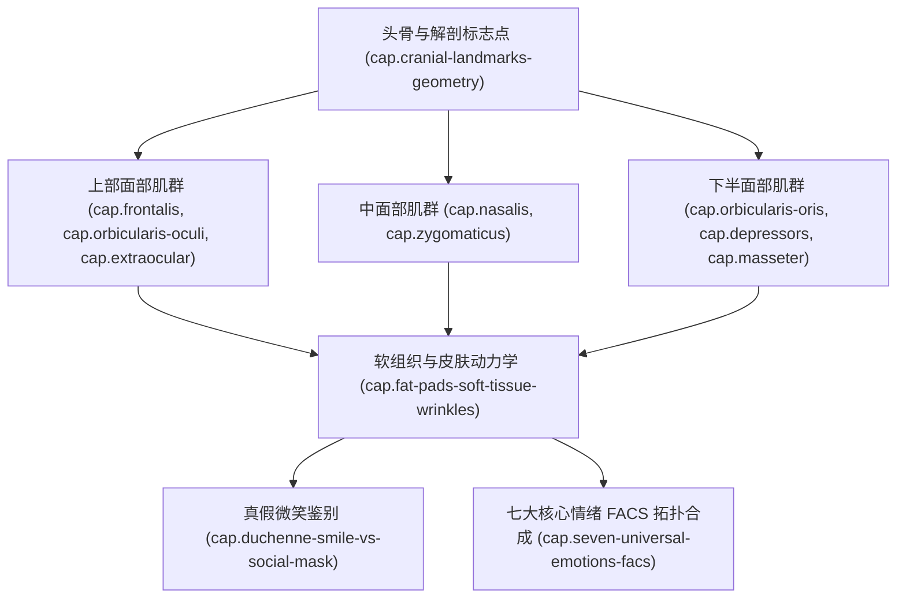

# 《面部表情艺用解剖》（Anatomy of Facial Expression）书籍架构与工程全貌概览

## 1. 著作元数据与历史定位

- **书名**：《面部表情艺用解剖》（Anatomy of Facial Expression: An Visual Reference for Artists）
- **主要作者**：Uldis Zarins（乌尔迪斯·扎林斯）、Sandis Kondrats（桑迪斯·孔德拉茨）
- **学术审校与贡献**：Dr. Pauls Keire、Rey Bustos（洛杉矶艺术中心设计学院与迪斯尼动画讲师）
- **出版团队**：Anatomy Next / Exonicus
- **页数**：222页 全彩解剖图谱与三维面部几何解析
- **核心定位**：全球三维角色艺术家、动画师、数字雕塑家与概念设计师奉为“面部结构第一圣经”的权威参考指南。该书将保罗·埃克曼（Paul Ekman）的面部动作编码系统（FACS - Facial Action Coding System）与达芬奇以降的经典古典人体解剖学完美统一，将不可见的面部肌肉肌腱起止点、深浅层脂肪垫、皮肤张力皱纹动力学，转化为可量化、可验证、可参数化绑定的三维空间几何法则。

---

## 2. 核心学术脉络与跨领域价值

传统的艺用解剖学教材往往停留在静态头骨与肌肉表面形态的描摹，缺乏面部肌肉在动态收缩下的力学传导规律；而心理学与医学领域的 FACS 研究虽精确定义了各个面部运动单元（Action Units, AU），却缺乏面向视觉艺术家的三维体积守恒、肌肉厚度衰减与高光形变解析。

《Anatomy of Facial Expression》填补了这一百年空白：
1. **骨骼标志点的刚性锚定**：揭示面部所有表情形变均围绕 10 大硬质骨骼标志点展开，骨骼永不变形，软组织沿骨面滑移。
2. **正交张力皱纹定律**：确立了“皮肤折痕/动态皱纹方向恒垂直于深层肌纤维收缩轴线”的普遍几何物理法则。
3. **FACS 与表情肌起止点的完全映射**：将 AU 1 至 AU 64 的心理学动作单元，与枕额肌、眼轮匝肌、口轮匝肌、大颧肌、降口角肌等 20 余组关键肌肉的起止点三维矢量精确锁定。
4. **杜氏真笑 vs 社交假笑的解剖本质**：厘清 AU 6（眼轮匝肌眶外环收缩抬起面颊并产生鱼尾纹）与 AU 12（大颧肌向上外侧拉升嘴角）的生物力学联动机制。
5. **七大核心人类表情与复合微表情**：对高兴（Joy）、悲伤（Sadness）、愤怒（Anger）、恐惧（Fear）、厌恶（Disgust）、惊讶（Surprise）、轻蔑（Contempt）进行逐帧、逐肌群的分解与重构。

---

## 3. 12 项 RIA++ 工业级能力卡规划

为实现工业级数字角色绑定（Rigging）、面部 BlendShape 雕刻、2D 角色关键帧表情动画及概念原画的无缝落地，本技能包规划了 12 项完全正交、高内聚、互不重复的核心能力卡：

1. **`cap.facial-expressions.cranial-landmarks-geometry`（头骨解剖标志点与面部几何体块锚定）**
   - 额骨、颧骨、上颌骨、下颌骨及眶上缘、下颌角等 10 大不可变形硬质标志点的识别与三维定位；头骨性别与年龄形态学变异。
2. **`cap.facial-expressions.frontalis-corrugator-eyebrow-dynamics`（枕额肌与降眉间肌-皱眉肌复合动力学 - AU 1/2/4）**
   - 枕额肌内侧（AU 1）与外侧（AU 2）解耦提升；皱眉肌与降眉肌（AU 4）拉拢下压；川字纹与额头横纹力学。
3. **`cap.facial-expressions.orbicularis-oculi-eyelid-mechanics`（眼轮匝肌、睑肌与眼睑张力闭合力学 - AU 5/6/7/43）**
   - 上睑提肌（AU 5）瞳孔露白；眼轮匝肌眶部（AU 6 脸颊抬升与鱼尾纹）与睑部（AU 7 眯眼紧绷）；眼睑厚度与球形眼球滑移。
4. **`cap.facial-expressions.extraocular-gaze-saccade`（眼外肌与视线扫视协同注视机制 - AU 61-64）**
   - 四直肌与双斜肌矢量合成；扫视（Saccade）跳跃与前庭眼反射；双眼会聚聚焦与视线微表情倾角。
5. **`cap.facial-expressions.nasalis-levator-midface`（鼻肌、提上唇鼻翼肌与中面部滑移 - AU 9/38/39）**
   - 鼻肌横部与翼部扩张/收缩；上唇鼻翼提肌强力皱鼻与鼻梁横纹；鼻唇沟（法令纹）几何起点与中面部推挤。
6. **`cap.facial-expressions.orbicularis-oris-lip-mechanics`（口轮匝肌同心环与唇形形变动力学 - AU 18/22/23/24）**
   - 口轮匝肌内外环收缩；漏斗唇（AU 22）、噘嘴（AU 18）、紧抿唇（AU 23/24）；唇珠、红唇白线与容积守恒展开。
7. **`cap.facial-expressions.zygomaticus-risorius-smile-vector`（颧大肌、颧小肌与笑肌嘴角矢量网络 - AU 11/12/13/20）**
   - 颧大肌 45度斜向外上拉伸（AU 12）；笑肌纯水平横向拉扯（AU 20 恐惧/紧张假笑）；提口角肌（AU 13）与颧小肌（AU 11）。
8. **`cap.facial-expressions.depressors-mentalis-mouth-corners`（降口角肌、降下唇肌与颏肌下半脸张力 - AU 15/16/17）**
   - 降口角肌倒U形拉扯嘴角（AU 15）；降下唇肌露出下牙（AU 16）；颏肌皱缩形成橘皮下巴并推高下唇（AU 17）。
9. **`cap.facial-expressions.masseter-temporalis-tmj-mechanics`（咬肌、颞肌与颞下颌关节咬合动力学 - AU 26/27/31）**
   - 咬肌与颞肌强力闭颌与咬紧牙关（AU 31）；TMJ 铰链旋转与平移滑动机制；下颌骨前伸、下沉（AU 26/27）与偏颌运动。
10. **`cap.facial-expressions.fat-pads-soft-tissue-wrinkles`（面部脂肪垫、韧带锚点与正交皮肤张力皱纹法则）**
    - 浅层与深层脂肪垫（Malar, SOOF, ROOF）；面部支持韧带（Zygomatic/Mandibular Ligaments）；兰格氏线（Langer's lines）与肌肉正交垂线皱纹发生学。
11. **`cap.facial-expressions.duchenne-smile-vs-social-mask`（杜氏真诚微笑与社交假笑解剖学鉴别 - AU 6+12 vs AU 12/20）**
    - 杜氏微笑双肌群联动闭环（AU 6 + AU 12 + AU 25）；社交礼貌微笑与嘲弄苦笑的眼轮匝肌剥离特征；面部非对称微表情鉴别。
12. **`cap.facial-expressions.seven-universal-emotions-facs`（人类七大普适核心情绪与复合微表情 FACS 拓扑合成）**
    - 悲伤（AU 1+4+15+17）、愤怒（AU 4+5+7+23+38）、恐惧（AU 1+2+4+5+20+26）、惊讶（AU 1+2+5+26）、厌恶（AU 9+10+15+17）、蔑视（单侧 AU 12/14）；混合情绪的时间线与强弱过渡拓扑。

---

## 4. 架构映射关系

