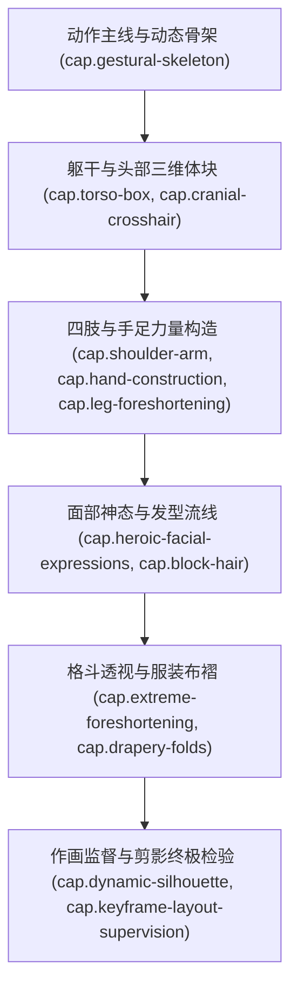

# 《超人气动画角色设计攻略：羽山淳一的现场绘画解说课》书籍架构与工程全貌概览

## 1. 著作元数据与大师定位

- **书名**：《超人气动画角色设计攻略：羽山淳一的现场绘画解说课》（羽山淳一のアニメ作画・キャラクターデザイン / Junichi Hayama Anime Drawing & Character Design Masterclass）
- **作者**：羽山淳一（Junichi Hayama，日本殿堂级资深动画家、原画师、角色设计师与总作画监督）
- **代表作品**：《北斗神拳》（作画监督）、《JoJo的奇妙冒险：星尘斗士》（总作画监督/角色设计）、《圣斗士星矢》（原画）、《魁!!男塾》（作画监督）、《大友克洋MEMORIES》（原画）、《黄金勇者》（角色设计）、《钢铁神吉克》（总作监）
- **出版方**：玄光社（日本专业动画美术权威出版社）
- **页数**：198页 纯手绘线稿、肌肉动态分步解说与作画监督实战批注
- **核心定位**：日本手绘商业动画（Sakuga）黄金时代“硬派热血角色设计与极限格斗动态作画”的巅峰实战教程。该书系统传授了如何在极其严苛的商业动画生产周期与高帧率动作戏中，以极简利落的动作线（Line of Action）、坚实的三维肌肉体块箱体、极具压迫感的三维空间透视短缩（Foreshortening），以及充满狂放动能的粗细线条压感，绘制出兼具视觉冲击力与工程中割（In-betweening）可行性的顶级动画原画。

---

## 2. 核心学术脉络与跨领域价值

传统的学院派艺用解剖学教材往往过于讲究静止状态下细碎肌肉群的死板描摹，导致画出的角色“肌肉很准，但动作僵死、毫无动能”；而二次元插画教程又往往沉迷于美化五官贴图与发丝细节，缺乏底层的三维几何空间感。

羽山淳一将日本商业动画半个世纪积累的“原画与作画监督工程学”提炼为四大核心力学：
1. **单一脊椎动作主线（The Single Dynamic Line of Action）**：摒弃繁琐轮廓，以贯穿角色全身的单一弧线确立动量方向、重心平衡与戏剧张力；
2. **胸腔箱与骨盆箱扭转对抗（Torso Box Contrapposto）**：将复杂躯干提炼为带三维透视的梯形体块，利用两者沿三轴方向的扭转（Twist）与倾斜（Tilt）赋予角色强大的肌肉紧绷感；
3. **极限空间透视短缩（Extreme Foreshortening）**：利用重叠（Overlap）、包裹线（Cross-contour）与近大远小的镜头畸变，将扑向镜头的拳头、飞踢与刀剑刻画出撕裂屏幕的三维压迫感；
4. **硬派影线分面与作监修形哲学（Action Hatching & Animation Supervision）**：用利落的 $45^{\circ}$ 经典动画排线（影线）确立面部与肌肉阴影分面，强化雄性力量感与决死意志；建立线条粗细重量感与中割保形规范。

---

## 3. 12 项 RIA++ 工业级能力卡规划

1. **`cap.hayama-character-design.gestural-skeleton-line-of-action`（脊椎动作主线与动态骨架极速提炼）**
   - 贯穿颈椎、脊柱至受力脚跟的单一 S形/C形动作主线；双足重力支撑三角面与动作重心投影；30秒极速姿态速写。
2. **`cap.hayama-character-design.cranial-crosshair-3d-rotation`（头部十字基准线与球面多角度三维旋转）**
   - 头部球体与下颌梯形块的三维透视转动；仰俯角下十字基准线弧度曲率；五官沿球面眼眶与牙弓贴合。
3. **`cap.hayama-character-design.heroic-facial-expressions-shadow`（热血角色面部表情与硬派影线分面）**
   - 怒吼、冷笑、决意与痛苦咬牙；经典热血动画 $45^{\circ}$ 斜向影线（Hatching）阴影分面与眼窝死黑。
4. **`cap.hayama-character-design.block-hair-airflow-dynamics`（体块化头发分组与受风飞扬动力学）**
   - 发束的三棱柱体块分组（主要发束、辅助发束、飞扬碎发）；发旋锚定点；受风力与角色冲刺动能带动的大面积飘拂。
5. **`cap.hayama-character-design.torso-box-contrapposto`（胸腔箱与骨盆箱的扭转对抗立体雕刻）**
   - 胸腔蛋形梯形箱 vs 骨盆倒梯形箱的三轴扭转与倾斜对抗；肋弓下缘、腹直肌三段阶梯与腹外斜肌张力。
6. **`cap.hayama-character-design.shoulder-arm-muscular-linkage`（锁骨、三角肌与手臂肌群旋转联动）**
   - 锁骨与肩胛骨连动；三角肌包裹肩关节；手臂内旋/外旋下的二头肌、三头肌与前臂旋前肌体块交错。
7. **`cap.hayama-character-design.hand-construction-power-grip`（手部体块几何构建与力量感抓握手势）**
   - 手掌厚度楔形块；掌骨弓与指关节阶梯高低差；握拳透视收缩与强力抓握手势的骨节咬合。
8. **`cap.hayama-character-design.leg-foreshortening-ground-contact`（腿部透视短缩与脚掌重力抓地力学）**
   - 大腿股四头肌前凸 vs 腘窝后凹；小腿肚双侧高低错位曲线；脚踝内外踝高低差与脚趾蹬地抓地缓冲。
9. **`cap.hayama-character-design.extreme-foreshortening-combat`（格斗出拳与飞踢的极限透视短缩法）**
   - 冲向镜头的拳击与前踢大透视；肢体环形重叠包裹线（Overlap）；消除“缩短畸变导致的手臂截肢错觉”。
10. **`cap.hayama-character-design.drapery-folds-costume-wind`（服装布褶动力学与斗篷风力流线）**
    - 七大布褶在热血动画中的提炼：拉伸辐射褶、关节挤压堆叠褶；风衣与斗篷在极速移动下的气流破风流线。
11. **`cap.hayama-character-design.dynamic-silhouette-readability`（纯黑剪影瞬间可读性与负空间力场）**
    - 纯黑剪影瞬间辨识度；肢体负空间窗口（Negative Space Windows）；动作意图与武器朝向的瞬间自明性。
12. **`cap.hayama-character-design.keyframe-layout-supervision`（作画监督级原画修正与中割保形规范）**
    - 原画修形（Layout Correction）；运笔速度与粗细线条重量感；关键帧极致张力与中割（In-betweening）轨迹平滑度。

---

## 4. 架构映射关系

