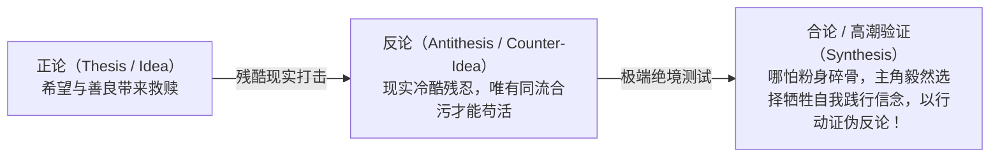
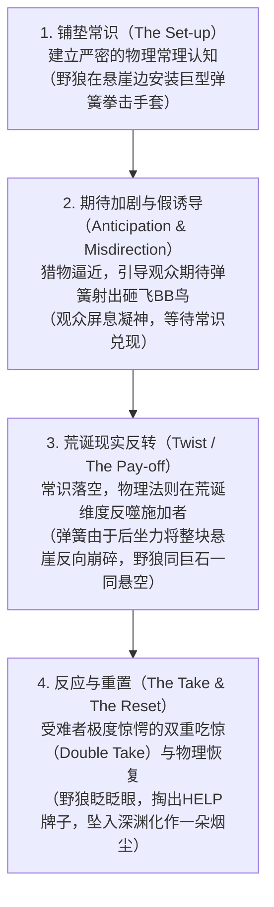
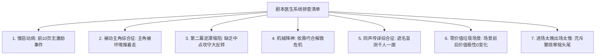
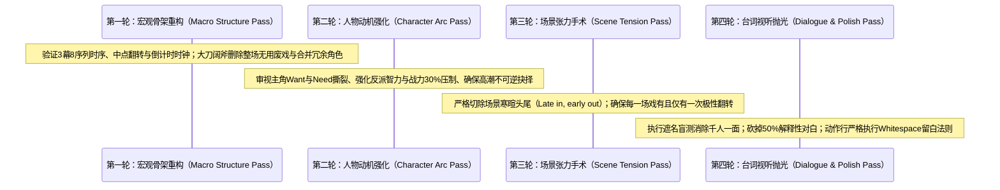
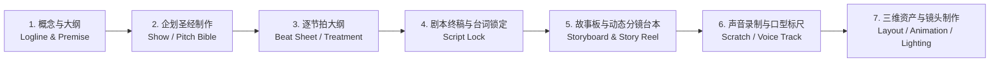

# 《电影故事编剧与动画剧本工程手册》人类终极导读与实战工程全书
## Industrial Screenplay & Story Engineering Master Guide

> **导读编者注**：本工程手册系统性蒸馏并融合了当代世界影视编剧与动画剧作领域的四大奠基级圣经：
> 1. **罗伯特·麦基（Robert McKee）** ——《故事：材质、结构、风格和银幕剧作的原理》（*Story: Substance, Structure, Style and the Principles of Screenwriting*）
> 2. **威廉·M·埃克斯（William M. Akers）** ——《你的剧本逊毙了！好莱坞资深剧本医生的 100 个诊断补救指南》（*Your Screenplay Sucks! 100 Ways to Make It Great*）
> 3. **悉德·菲尔德（Syd Field）** ——《电影剧本写作基础》（*Screenplay: The Foundations of Screenwriting*）与《编剧步步为营》（*The Screenwriter's Workbook*）
> 4. **杰弗里·斯科特（Jeffrey Scott）** ——《动画剧本创作与营销：艾美奖得主的商业动画实战指南》（*How to Write for Animation*）
> 
> 本导读旨在彻底打破“编剧是不可言说的神秘灵感缪斯”这一误区，从**叙事工程力学**、**人物心智动力学**、**场景能量极性转换**、**对白潜台词冰山算法**与**好莱坞工业施工图纸规范**的高度，为电影导演、独立编剧、动画分镜师、剧集策划人建立不可动摇的底层创作脚手架。

---

# 目录索引

- [第一篇：宏观故事建筑力学与时序范式](#第一篇宏观故事建筑力学与时序范式)
  - [1.1 经典三幕八序列架构时序标尺（The Structural Metric）](#11-经典三幕八序列架构时序标尺the-structural-metric)
  - [1.2 中点危机攻守反转与倒计时时钟（The Midpoint Revolution）](#12-中点危机攻守反转与倒计时时钟the-midpoint-revolution)
  - [1.3 主导论题与哲学因果矩阵（Controlling Idea & Dialectics）](#13-主导论题与哲学因果矩阵controlling-idea--dialectics)
- [第二篇：人物动力学与对抗力量方阵](#第二篇人物动力学与对抗力量方阵)
  - [2.1 欲望撕裂：显性欲望Want vs 隐性精神需求Need](#21-欲望撕裂显性欲望want-vs-隐性精神需求need)
  - [2.2 心理幽灵创伤与致命缺陷（The Ghost & Tragic Flaw）](#22-心理幽灵创伤与致命缺陷the-ghost--tragic-flaw)
  - [2.3 自洽正义反派与四级矛盾升级方阵（Forces of Antagonism）](#23-自洽正义反派与四级矛盾升级方阵forces-of-antagonism)
- [第三篇：微观场景力学与台词视听解耦](#第三篇微观场景力学与台词视听解耦)
  - [3.1 场景能量极性翻转与残酷现实断层（Gap in Reality）](#31-场景能量极性翻转与残酷现实断层gap-in-reality)
  - [3.2 晚进早出与切除废戏（Late In, Early Out）](#32-晚进早出与切除废戏late-in-early-out)
  - [3.3 海明威冰山理论与对白潜台词（Dialogue Subtext）](#33-海明威冰山理论与对白潜台词dialogue-subtext)
  - [3.4 背景信息武器化投放与遮名盲测（Exposition as Ammunition）](#34-背景信息武器化投放与遮名盲测exposition-as-ammunition)
- [第四篇：动画剧作特化语法与视觉笑料工程](#第四篇动画剧作特化语法与视觉笑料工程)
  - [4.1 纯视觉优先：Show Don't Tell 的极限形态](#41-纯视觉优先show-dont-tell-的极限形态)
  - [4.2 经典四步视觉笑料结构力学（The Visual Gag Cycle）](#42-经典四步视觉笑料结构力学the-visual-gag-cycle)
  - [4.3 拟人化逻辑守恒与物理定律的橡皮泥形变](#43-拟人化逻辑守恒与物理定律的橡皮泥形变)
  - [4.4 经典 22 分钟商业动画剧集结构时序](#44-经典-22-分钟商业动画剧集结构时序)
- [第五篇：戏剧危机、高潮决战与叙事闭环](#第五篇戏剧危机高潮决战与叙事闭环)
  - [5.1 危机绝境：两害相权取其轻与不可兼得之善（The Dilemma）](#51-危机绝境两害相权取其轻与不可兼得之善the-dilemma)
  - [5.2 终极高潮的物理不可逆性与哲学验证](#52-终极高潮的物理不可逆性与哲学验证)
  - [5.3 副线交织与群像功能网络（Sub-plot Orchestration）](#53-副线交织与群像功能网络sub-plot-orchestration)
- [第六篇：好莱坞工业施工规范与剧本医生外科手术](#第六篇好莱坞工业施工规范与剧本医生外科手术)
  - [6.1 好莱坞标准排版与留白艺术（The Whitespace Rule）](#61-好莱坞标准排版与留白艺术the-whitespace-rule)
  - [6.2 强动词现在时与杜绝不可拍摄内容（No Unfilmables）](#62-强动词现在时与杜绝不可拍摄内容no-unfilmables)
  - [6.3 动画企划圣经（Show Bible）七大模块与 Logline 黄金公式](#63-动画企划圣经show-bible七大模块与-logline-黄金公式)
  - [6.4 剧本医生七大致命病灶排查清单](#64-剧本医生七大致命病灶排查清单)
  - [6.5 四轮降维重写外科手术流水线（The Four-Pass Rewrite）](#65-四轮降维重写外科手术流水线the-four-pass-rewrite)
- [第七篇：经典殿堂级作品拉片解剖室](#第七篇经典殿堂级作品拉片解剖室)

---

# 第一篇：宏观故事建筑力学与时序范式

## 1.1 经典三幕八序列架构时序标尺（The Structural Metric）

在好莱坞长片电影工业中，剧本页数与放映时长存在着严格的对应关系：**1 页标准排版剧本 = 60 秒银幕时间**。一部标准的 110-120 页长片电影剧本，其宏观建筑力学结构必须严密锚定在如下时序刻度上：

```
0m ------------------ 30m --------------------------------- 90m ----------------- 120m
|       第一幕 (Act I)  |               第二幕 (Act II)             |     第三幕 (Act III)  |
| 铺垫与触发 (Setup)    |           对抗与试炼 (Confrontation)       | 决战与收束 (Resolution)|
        ^                      ^                     ^                    ^
    激励事件 (10-12m)      情节点 I (27-30m)     中点危机 (55-60m)    情节点 II (85-90m)
```

### 序列化细分（The Eight-Sequence Method）
为了彻底解决剧本创作者在第二幕长达 60 页中常常陷入的“中段塌陷（Sagging Second Act）”，好莱坞建立了**八序列（8-Sequence）**力学模型，将整部电影拆解为 8 个各自时长约 12-15 分钟、具备完整起承转合与次级悬念的独立微型戏剧单元：

1. **序列 A（第 1-15 页）：现状与激励事件（Status Quo & Inciting Incident）**
   - 建立主角的日常生活与致命内在缺陷；展示世界的不平衡；
   - 在第 10-12 页引爆激励事件，彻底打破旧世界的平衡态。
2. **序列 B（第 15-30 页）：抗拒与跨越第一道门槛（Predicament & Plot Point I）**
   - 主角试图用过去的旧习惯或懒惰策略去解决麻烦，遭到现实的无情反击；
   - 在第 27-30 页被迫做出**不可逆的选择**，跨越第一道门槛（Plot Point I），被抛入未知的新世界。
3. **序列 C（第 30-45 页）：初入新世界与上升冲突（First Obstacle & Rising Stakes）**
   - 主角结识新盟友与导师，接触新环境的游戏规则；
   - 遇到第一个真正的严峻阻碍并勉强过关，获得短暂的虚假自信。
4. **序列 D（第 45-60 页）：中点逼近与攻守大反转（Approaching the Midpoint）**
   - 阻力骤然升级，反派力量开始主动反扑；
   - 在第 55-60 页爆发**中点危机（Midpoint Crisis）**：要么迎来虚假的巨大胜利（False Victory），要么遭遇毁灭性的虚假失败（False Defeat）。
5. **序列 E（第 60-75 页）：反冲与深渊下坠（Fallout & Deepening Complications）**
   - 中点的余波彻底撕毁了主角原有的安全网，反派开始全面追杀；
   - 主角原有的欲望手段彻底失效，心理幽灵创伤全面发作。
6. **序列 F（第 75-90 页）：全面溃败与灵魂暗夜（All Hope Is Lost & Dark Night of the Soul）**
   - 盟友背叛或导师牺牲，主角遭遇最惨烈的全盘崩溃；
   - 在第 85-90 页（情节点 II），主角跌入绝望深渊，在万念俱灰中迎来关键的**精神顿悟（Epiphany）**。
7. **序列 G（第 90-105 页）：重整旗鼓与终极冲刺（Regrouping & Final Push）**
   - 主角彻底舍弃虚妄的外在欲望（Want），拥抱真实的内在需求（Need）；
   - 制定破釜沉舟的决战计划，直捣反派的核心巢穴。
8. **序列 H（第 105-120 页）：终极决战与全新平衡（Climax & Resolution）**
   - 爆发全片最高强度的物理与道德交锋；
   - 主角付出巨大代价击败反派或达成和解，世界确立全新的更高维平衡。

---

## 1.2 中点危机攻守反转与倒计时时钟（The Midpoint Revolution）

**中点（Midpoint，第 55-60 页）是整个剧本的心脏与承重柱**。如果中点没有发生实质性的动态翻转，故事就会在第二幕原地打转，沦为一系列乏味的打怪升级。

### 中点的两大核心工程职能：
1. **攻守立场的彻底颠倒（Polarity Reversal）**：
   - 若前半部主角处于被动防守与逃避状态，中点必须迫使主角转守为攻（例如从“躲避警察”转为“主动设局追查真凶”）；
   - 若前半部主角顺风顺水沉浸在虚假繁荣中，中点必须给予当头棒喝，让其意识到自己落入了反派的巨大陷阱（例如《侏罗纪公园》中恐龙逃出牢笼，观光之旅瞬间变为生死逃亡）。
2. **启动不可逆的倒计时时钟（The Ticking Clock）**：
   - 中点必须确立一个迫在眉睫的物理截止期限（如“日落之前”、“氧气耗尽前的 48 小时”、“月圆之夜”）；
   - 倒计时的引入极大地压缩了戏剧时空，使第二幕下半场的每一分钟都承载着极高的窒息感与紧迫感。

---

## 1.3 主导论题与哲学因果矩阵（Controlling Idea & Dialectics）

罗伯特·麦基在《故事》中强调：**伟大的故事从来不是由作者的说教意图驱动的，而是由一个清晰的主导论题（Controlling Idea）在辩证交锋中最终胜出的过程**。

### 主导论题的严密工程公式：
$$\text{主导论题} = \text{核心行为价值（Cause）} \implies \text{最终生命终局（Effect）}$$

- **命题示例（《肖申克的救赎》）**：“坚韧不拔的希望与忍耐（Cause）最终能够击穿最严酷的体制化高墙并赢得真正的心灵自由（Effect）。”
- **命题示例（《教父》）**：“为了保护家族而向无情的权力暴力妥协（Cause）最终必将导致自我灵魂的腐化与家庭关系的彻底毁灭（Effect）。”

### 正论与反论的辩证对抗矩阵（The Dialectic Matrix）
一个成熟的编剧必须在故事推进中充当“自己理念的最残酷敌人”。故事不能一边倒地为正论唱赞歌，必须构建势均力敌的辩证交锋：



**终极高潮的验证原则**：主导论题的真理性，绝对不能靠角色的嘴巴念出来，而必须通过主角在最极端的生死关头所付出的**惨烈物理行动与不可逆代价**来向观众证明。

---

# 第二篇：人物动力学与对抗力量方阵

## 2.1 欲望撕裂：显性欲望Want vs 隐性精神需求Need

扁平的角色只有愿望，立体的角色永远活在**外在欲望（Want）与内在需求（Need）的剧烈撕裂中**：

| 维度 | 外在显性欲望（The Want） | 内在隐性精神需求（The Need） |
| :--- | :--- | :--- |
| **定义** | 角色意识层面的具体目标（如赢得奖杯、赚取百万美金、当上董事长） | 角色潜意识层面的心灵救赎（如学会信任他人、放下控制欲、接纳自己的平庸） |
| **驱动源** | 由虚荣心、恐惧或对外界认可的渴望驱动 | 由角色受伤的灵魂深处的良知与同理心驱动 |
| **真伪性** | 虚妄的伪解药（以为得到了就能幸福） | 真正能够带来心灵安宁与成熟的终极良方 |
| **高潮抉择** | **在高潮到来时必须被角色主动抛弃或献祭** | **在高潮到来时被角色完全拥抱与实现** |

- **经典案例（《赛车总动员》闪电麦昆）**：
  - **Want**：赢得活塞杯冠军，成为恐龙机油的唯一代言人，享受万人瞩目；
  - **Need**：懂得尊重他人，明白友情与团队互助远比奖杯重要的多；
  - **高潮抉择**：在即将冲过终点线夺冠的瞬间，看到老车王撞车重伤，麦昆猛踩刹车放弃了近在咫尺的活塞杯，转头推着老车王冲过终点。在舍弃 Want 的那一刹那，麦昆完成了神级的人格蜕变。

---

## 2.2 心理幽灵创伤与致命缺陷（The Ghost & Tragic Flaw）

一个角色之所以在故事开场时执迷不悟于虚妄的 Want，根源在于其内心深处潜伏着一个**幽灵创伤（The Ghost / Wound）**。

1. **幽灵创伤的定义**：在故事时间线开始前数年，角色经历过的重大心理打击、背叛、遗弃或耻辱事件；
2. **防御机制（Defense Mechanism）**：为了避免再次体会创伤的剧痛，角色发展出一种病态的行为防卫模式（如“永远不要信任任何人”、“用绝对的冷血控制一切”、“用插科打诨掩饰内心的懦弱”）；
3. **致命缺陷（The Fatal Flaw）**：这种防卫模式在日常生活中成为了角色的致命弱点，直接导致其人际关系的恶化与人生的停滞不前；
4. **全盘崩塌与重生**：整个剧本的全部故事情节，本质上就是由宇宙设计的一台**无情的手术台**，通过层层升级的外部危机，无情剥去角色的防卫外壳，逼迫其正视幽灵，最终战胜心魔。

---

## 2.3 自洽正义反派与四级矛盾升级方阵（Forces of Antagonism）

### 黄金铁律：反派是他自身世界的主角（The Villain is the Hero of His Own Story）
三流编剧写恶棍因为“坏”而杀人；顶级编剧塑造的反派，其道德正义感甚至比主角还要强烈，其行为逻辑在自身世界观中具备坚不可摧的崇高性与自洽性：
- 《复仇者联盟》灭霸：目睹泰坦星资源耗尽文明毁灭的惨剧（幽灵），为了全宇宙生态系统的长久延续而背负恶名抹除半数生命；
- 《黑豹》齐尔蒙格：目睹全世界黑人同胞受奴役压迫，为了推翻殖民统治建立平等新世界而掀起武装起义。

### 罗伯特·麦基四级对抗方阵（McKee's Square of Antagonism）
对抗力量绝不能仅仅停留在单一维度的物理打斗，必须沿着道德价值的四级光谱层层升级：

```
                    【正向价值（Positive）】
                           例如：爱 / 正义
                             /         \
                            /           \
                           /             \
【矛盾价值（Contradictory）】 ------------- 【对立价值（Contrary）】
      例如：冷漠 / 不公                        例如：恨 / 腐败
                           \             /
                            \           /
                             \         /
                   【否定之否定（Negation of Negation）】
                   例如：伪装成大爱的自我毁灭 / 极权暴政
```

1. **正向价值（Positive）**：如真爱、公正、自由；
2. **矛盾价值（Contradictory）**：直接的对立面（如不爱、冷漠、偏见）；
3. **对立价值（Contrary）**：敌对的极端状态（如仇恨、恶意背叛、直接犯罪）；
4. **否定之否定（Negation of Negation）**：最深层的恶往往伪装成极致的善（如打着“为了你幸福”旗号的精神控制与变态虐待、打着“为了全人类福祉”旗号实施的反人类种族清洗）。故事的高潮必须将对抗力量推向“否定之否定”的极致深渊。

---

# 第三篇：微观场景力学与台词视听解耦

## 3.1 场景能量极性翻转与残酷现实断层（Gap in Reality）

场景不是情节碎片的无序堆砌，**每个独立的场景都是一部微型的电影**。罗伯特·麦基指出：一个合格的场景必须包含**价值状态的正负极翻转（Polarity Turn）**。

$$\text{场景入场状态} \xrightarrow{\quad \text{行动与现实断层（Gap）} \quad} \text{场景出场状态（相反极性）}$$

- 如果一个场景开始时角色充满希望（+），经历了一番波折后，结尾时角色依然充满希望（+），那么这个场景在戏剧力学上就是**零价值的死肉**，必须立即删除！
- 场景必须从（+）翻转为（-），或者从（-）翻转为（+）。

### 残酷现实断层（The Gap in Reality）的力学运作：
1. **主观预期（Expectation）**：角色采取行动，理所当然地认为客观世界会给予某种反馈；
2. **客观反弹与断层爆发（The Gap Opens）**：现实世界（外部物理规律、对手意志、不可控意外）给出了完全超出角色预期的残酷阻击；
3. **能量释放与代价加倍**：现实的断层将角色的期望粉碎，逼迫角色在惊愕之余承担更严重的损失，并必须调用更深层级的情感力量采取下一次更大冒险的行动。

---

## 3.2 晚进早出与切除废戏（Late In, Early Out）

好莱坞资深剧本医生威廉·M·埃克斯的核心戒律：**“永远在最后一秒切入场景，在冲突高潮落定的那一刹那立刻切出！”**

- **反模式拖沓场景**：角色敲门 $\rightarrow$ 进门寒暄“今天天气不错” $\rightarrow$ 脱外套挂在衣架上 $\rightarrow$ 坐下倒咖啡 $\rightarrow$ 开始谈论秘密账本 $\rightarrow$ 爆发争吵 $\rightarrow$ 角色气冲冲站起来 $\rightarrow$ 穿上外套 $\rightarrow$ 走出大门并关门。
- **工业外科手术改写**：直接切到角色一掌拍在桌子上的特写：“账本上的两百万去哪了？！” $\rightarrow$ 对手冷笑从抽屉拔出枪对准其眉心 $\rightarrow$ 黑场切出！

---

## 3.3 海明威冰山理论与对白潜台词（Dialogue Subtext）

### 剧作黄金法则：台词不是用来传达信息的，台词是用来进行权力角斗的武器
在真实的人类社交中，人们几乎从不直接说出心中所想。台词必须由**表面文本（Text）与深层潜台词（Subtext）**二元构成：

```
       ▲  [露出海面的 1/8 冰山] 表面台词（Text）：“这杯咖啡真凉。”
═══════╬══════════════════════════════════════════════════════════════════════
       ▼  [隐匿水下的 7/8 冰山] 深层潜台词（Subtext）：“我根本不想再在这个家里和你多呆一秒，我们的婚姻已经彻底死透了。”
```

**判断台词平庸的标准**：如果一个角色说“我很愤怒”，读者就只知道他很愤怒，这是最拙劣的台词。如果一个角色面带微笑、语气温柔地询问对方领带的牌子，但手中削苹果的折叠刀却深深扎入木质桌面，这种强烈的文本与潜台词错位才能引发观众脊背发凉的戏剧张力。

---

## 3.4 背景信息武器化投放与遮名盲测（Exposition as Ammunition）

### 严禁“正如你所知，鲍勃”（The Dreaded 'As You Know, Bob'）
编剧最常见的偷懒病，就是让两个角色站在走廊里互相陈述大家都心知肚明的世界观背景信息。这种信息交代（Exposition）会彻底杀死剧情活力。

**信息武器化（Exposition as Ammunition）法则**：
- 只有当一个秘密或背景信息成为**摧毁对手防御的唯一子弹**时，角色才被允许说出它！
- 让角色在极度恐惧、疯狂愤怒或生死逃亡的激烈肉搏中，为了击垮对方心理防线而被迫将背景信息作为武器狠狠掷向对方。

### 遮名盲测（The Dialogue Blind Test）
拿出一张纸遮住剧本中所有角色的名字，仅阅读纯台词文本：
- 如果你无法根据句式长度、词汇习惯、修辞风格和思考逻辑一眼分辨出哪句话是谁说的，说明你的剧本患上了严重的“同声传译综合征（Same Voice Syndrome）”——所有角色全都在替编剧一个人传声。必须对每个角色的发音习惯进行彻底重铸！

---

# 第四篇：动画剧作特化语法与视觉笑料工程

## 4.1 纯视觉优先：Show Don't Tell 的极限形态

艾美奖动画编剧大师杰弗里·斯科特（Jeffrey Scott）指出：**动画电影与真人的本质区别在于其纯视觉可塑性（Infinite Visual Plasticity）**。

1. **台词配额减半法则**：在真人剧本中 1 页约等于 1 分钟；但在高质量商业动画中，由于视觉动作、物理形变、背景微动作极其密集，1 页剧本往往承载着超过 90 秒的庞大视觉表演量。任何能通过肢体语言、眼神移动或物理笑料展现的情感，坚决把台词砍光！
2. **极高动作密度（Extreme Action Pacing）**：动画观众对停滞的对话场景耐受度极低。在动画中，角色即便是坐着谈话，手头也必须伴随着夸张的副动作（如一边说话一边用牙齿拆卸微型炸弹、一边喝水一边因听见坏消息而喷出一道壮观的水箭）。

---

## 4.2 经典四步视觉笑料结构力学（The Visual Gag Cycle）

无论是迪士尼、皮克斯，还是华纳查克·琼斯经典的《兔八哥》《猫和老鼠》，高级视觉笑料（Visual Gag）的诞生绝非随意搞笑，而是严格遵循力学闭环：



---

## 4.3 拟人化逻辑守恒与物理定律的橡皮泥形变

当赋予动物、汽车或日常用具人类心智时，必须严格遵守**生物物理属性守恒律**：
- 《疯狂动物城》：树懒闪电在车管所工作，它的思维理解人类的笑话，但它的神经突触传导速率和肌肉运动严格遵守树懒极其迟缓的生理特性；
- 《玩具总动员》：玩具们在人类视线移开时拥有生命，但一旦人类突然推门进来，所有玩具必须瞬间丧失生命体征恢复塑料/布料的死物重力形态（物理法则作为戏剧风险的悬剑）。

---

## 4.4 经典 22 分钟商业动画剧集结构时序

杰弗里·斯科特为全球商业电视动画制定的工业标准结构表：

| 幕次 / 阶段 | 对应页数 | 戏剧时序与关键任务 |
| :--- | :--- | :--- |
| **第一幕 Part A** | 第 1-5 页 | **快速建立与激励故障**：展示主角日常常态，突发意外事件打破平衡，主角惹出棘手麻烦 |
| **第一幕 Part B** | 第 6-11 页 | **愚蠢尝试与危机升级**：主角试图用偷懒走捷径的手段掩盖麻烦，导致事态扩大 10 倍（**商业广告插播点 1 悬念悬挂**） |
| **第二幕 Part A** | 第 12-17 页 | **灾难失控与众叛亲离**：秘密彻底败露，麻烦演变为全城灾难，反派全面控场，主角失去盟友信任（**商业广告插播点 2 极度低谷**） |
| **第二幕 Part B** | 第 18-22 页 | **终极决战与悟性破局**：主角终于意识到真正的错误所在，与盟友合力利用高密度视觉奇观与物理笑料力挽狂澜，重建更高秩序 |

---

# 第五篇：戏剧危机、高潮决战与叙事闭环

## 5.1 危机绝境：两害相权取其轻与不可兼得之善（The Dilemma）

在第二幕末尾（情节点 II）爆发的**危机（The Crisis）**，是全片最严酷的灵魂烤炉。平庸编剧给出的危机是“做正确的事还是做错误的事”，这毫无戏剧张力；**伟大的危机必须设计为真正的两难困境（Dilemma）**：

1. **不可兼得的两种极致之善（Two Irreconcilable Goods）**：
   - 坚守对家人的忠诚，还是坚守对国家大义的忠诚？
   - 追求全人类的和平繁荣，还是保全眼前最挚爱的唯一恋人？
2. **两害相权取其轻（The Lesser of Two Evils）**：
   - 牺牲自己唯一的孩子，还是眼睁睁看着整座城市的几十万平民被毒气吞没？
   - 屈辱地向恶魔低头苟活，还是让整个族群面临彻底灭绝的厄运？

**主角在面对危机时作出的终极抉择，彻底定义了主角的灵魂成色！**

---

## 5.2 终极高潮的物理不可逆性与哲学验证

高潮（The Climax）绝不是轰轰烈烈的爆炸声效竞赛，高潮是**世界法则的终极物理不可逆重构**：

- **禁止廉价大团圆（No Free Lunch）**：主角绝不可能既拯救了世界，又发了大财，还毫发无损地抱得美人归。为了击碎反派，主角必须献祭自己最珍贵的事物（一条手臂、名誉、财富、甚至是肉体生命）；
- **物理行动闭环**：高潮必须由主角主动作出的物理动作引爆（按下开关、扣动扳机、跃下深渊、松开抓紧宝藏的手），坚决杜绝任何机械降神（Deus Ex Machina）和天降奇兵解围！

---

## 5.3 副线交织与群像功能网络（Sub-plot Orchestration）

一部单薄的故事只有 A 线主情节（A-Story）；丰富的故事必然拥有 1-2 条精妙交织的副线（B-Story 爱情/亲情线，C-Story 导师/对手副线）：

1. **副线的主题回响职能（Thematic Resonance）**：
   - 副线绝不是为了水时长而插入的无聊琐事。副线必须作为主导论题的**镜像棱镜**，从完全不同的角度对主线的核心价值进行探讨；
   - 例如：主线讲述主角在战场上学会“信任”；副线则讲述军营厨师与流浪狗之间建立“信任”的喜剧副线。
2. **群像角色功能网络（The Ensemble Archetypes）**：
   - 每一个出场的配角，必须在主角的心灵地图上占据唯一的坐标：
     - **导师（Mentor）**：揭示 Need 的本质，但通常无法陪伴主角走完最后一程；
     - **弄臣/小丑（Trickster）**：用幽默打破虚妄的权威，以荒诞方式指出真相；
     - **怀疑者/阻碍者（Skeptic）**：不断质疑主角的动机，测试主角的决心；
     - **镜子（Mirror）**：展现如果主角继续执迷不悟于 Want，未来将会沦落为何等悲惨下场。
3. **副线与主线的高潮合流（Climactic Convergence）**：
   - 在进入第三幕前，副线的情感势能必须作为关键催化剂汇入主线，副线中看似不起眼的小技能或小道具，成为打破主线僵局的致命钥匙。

---

# 第六篇：好莱坞工业施工规范与剧本医生外科手术

## 6.1 好莱坞标准排版与留白艺术（The Whitespace Rule）

好莱坞工业标准剧本采用严格的 Courier 12pt 单倍行距排版。制片人与导演在审读剧本时，阅读节奏必须与银幕观影节奏保持完全同步。

### 留白艺术（The Whitespace Rule）
**消灭一切黑色大字块（Walls of Text）！**
- 任何人眼连续看到超过 4 行密不透风的动作描述，大脑注意力就会立刻断崖式下跌；
- 将长段落切分为 1-2 行的极简动作组块，用大量的白色纸张留白（Whitespace）模拟摄影机剪辑镜头的快速切换，给予读者清晰明快的视听节奏感。

---

## 6.2 强动词现在时与杜绝不可拍摄内容（No Unfilmables）

### 坚决消灭不可拍摄心理描写（Unfilmables）
摄影机是一个冷酷无情的物理光学仪器，它只能记录光线反射与声波震动，无法拍摄角色脑子里的想法与未说出的历史背景。

| 业余编剧的致命错误（不可拍摄心理流） | 工业标准重构法（外部视听转译） |
| :--- | :--- |
| “玛丽走了进来，她心中依然对十年前父亲的离世充满了怨恨，她痛恨这个房间里的一切。” | “玛丽站在门槛前。她盯着墙上父亲的黑白遗像，拳头握得指节发白。她抓起桌上的相框，猛地反扣在桌面上。” |
| “鲍勃是个极其贪婪的人，他表面上是个好职员，但骨子里盘算着怎么卷款跑路。” | “鲍勃一边对着经理谄媚地点头哈腰，一边背过手去，用美工刀小心翼翼地划开保险箱边缘的封条。” |

### 消灭弱动词与运镜指示（Kill Camera Directions）
- 严禁使用 `is walking slowly`，替换为 `shuffles`、`ambles` 或 `creeps`；
- 严禁出现 `WE SEE`、`CAMERA PANS TO`、`CLOSE UP ON`。想要引导特写，只需将该物体单独占用一行即可：

```text
马克举起双手。

手枪。乌黑发亮，保险栓已然打开。
```

---

## 6.3 动画企划圣经（Show Bible）七大模块与 Logline 黄金公式

### Logline 黄金公式
$$\text{Logline} = [\text{具内在缺陷的主角}] + [\text{突发激励事件}] + [\text{必须达成的明确外在目标}] + [\text{强大的对抗阻力}] + [\text{失败的毁灭性代价}]$$

### 企划圣经（Pitch Bible）七大工业模块：
1. **Title & Logline**：视觉概念海报与 25 字高概念 Logline；
2. **Overview & Demographics**：目标受众年龄（Preschool 3-5 / Kids 6-11 / YA 12-17）、单集时长、对标作品；
3. **World Rules**：世界观物理与魔法运行法则，边界定义幽默；
4. **Character Dossiers**：角色设计图、核心欲望、致命弱点与性格化学反应矩阵；
5. **Episode Generator Engine**：能够源源不断产生 100 集故事的永动机戏剧机制；
6. **Pilot Episode Springboard**：第一集样集完整三幕节拍大纲；
7. **Episode Springboards (10-20)**：后续 10-20 集一句话剧情概念池。

---

## 6.4 剧本医生七大致命病灶排查清单



---

## 6.5 四轮降维重写外科手术流水线（The Four-Pass Rewrite）

严禁在同一遍重写中试图修复所有问题。必须遵循好莱坞工业的四轮降维流水线：



---

# 第七篇：经典殿堂级作品拉片解剖室

## 案例 1：《寻梦环游记》（Coco，皮克斯动画长片）
- **主角**：米格（Miguel）
- **Want**：不顾家人反对，成为像歌神德拉库斯一样的伟大音乐家，在音乐节上夺得冠军；
- **Need**：理解家庭羁绊的真正真谛，明白记忆与亲人的爱远比个人的虚名更珍贵；
- **激励事件**：吉他被祖母砸碎，米格潜入墓地盗取歌神的吉他，意外穿越到亡灵世界；
- **中点危机**：米格终于见到了歌神德拉库斯并获得了假祝福，但真正的真相被撕开——德拉库斯当年谋杀了埃克托并窃取了所有歌曲！攻守彻底颠倒，米格被扔入地下天坑深渊；
- **灵魂暗夜**：埃克托即将因被太奶奶遗忘而化作金粉彻底消散，米格意识到自己曾经崇拜的偶像是个卑鄙小人，而眼前这个落魄的流浪汉正是自己的亲曾祖父；
- **高潮抉择**：米格放弃了对音乐成名的执念，拼死将埃克托的照片带回人间；在人间他为太奶奶可可弹唱《Remember Me》，唤醒了可可对父亲的记忆，拯救了埃克托的灵魂。

## 案例 2：《疯狂动物城》（Zootopia，迪士尼动画长片）
- **主角**：朱迪（Judy Hopps）
- **Want**：证明兔子也能成为最优秀的刑警，破解全城失踪大案赢得尊重；
- **Need**：破除自己内心深处对食肉动物的隐秘偏见与傲慢，学会真正的平等与同理心；
- **中点危机**：朱迪与尼克找到了全部 14 只失踪的食肉动物并抓捕了狮子市长，迎来了巨大的虚假胜利（False Victory）；
- **转折反噬**：在新闻发布会上，朱迪受潜意识偏见影响发表了“食肉动物野性基因发作”的错误言论，瞬间撕裂了整座城市的族群互信，并彻底伤害了尼克。朱迪引咎辞职，回到胡萝卜农场，跌入人生的灵魂暗夜；
- **高潮抉择**：朱迪在夜嚎怪真相大白后痛哭着向尼克道歉，放下了自己作为执法者的骄傲，二人紧密配合用录音胡萝卜笔反将羊副市长一军，化解了整座城市的种族危机。

---

> **结语**：剧作不仅是灵感的火花，更是一门严谨的叙事力学工程。遵循这些经过百年工业验证的黄金定律，每一位创作者都能将脑海中粗糙的故事毛坯，雕琢为经得起时间考验的银幕经典。


---

# 第八篇：好莱坞大师级电影全景逐幕拉片解剖室

## 8.1 《教父》（The Godfather，弗朗西斯·福特·科波拉）——悲剧性弧光与权力异化

### 宏观三幕与序列力学解剖：
- **主角**：迈克尔·柯里昂（Michael Corleone）
- **开场状态与幽灵创伤**：迈克尔身穿二战军装带着女友凯参加姐姐的婚礼，极力划清与家族的界限：“那是我的家族，凯，那不是我。”（Want：成为主流美国公民，脱离黑帮犯罪）。
- **激励事件（第 15 分钟）**：老教父维托·柯里昂在街头遭遇刺客枪击重伤垂危。权力真空瞬间打破纽约五大家族的平衡态。
- **情节点 I（第 35 分钟，跨越门槛）**：迈克尔在医院孤身保护父亲免遭二次刺杀，第一次感受到警察队长麦克劳斯基的暴力腐败。在家族会议上，迈克尔主动提议：“由我去跟索洛佐和麦克劳斯基谈判，然后杀了他们两个。”——**这是迈克尔一生的不可逆分水岭！**
- **第一幕至第二幕转折动作**：意大利餐馆枪击戏。迈克尔从卫生间水箱后取出左轮手枪，耳边回荡着刺耳轰鸣的列车摩擦铁轨声（内心心理外化），冷静射杀索洛佐与麦克劳斯基，随后将枪扔在地上（遵循克莱门扎的指导）。
- **中点危机（第 85 分钟）**：迈克尔流亡西西里岛，爱上阿波罗妮亚并成婚；但纽约爆发全面黑帮战争，大哥桑尼在收费站被乱枪打成筛子；紧接着西西里发生汽车炸弹暗杀，新婚妻子惨死。**攻守彻底颠倒**：迈克尔原有的逃避幻想彻底粉碎，他必须返回纽约接管家族教父权柄。
- **第二情节点（第 125 分钟，灵魂暗夜）**：老教父突发心脏病去世。泰西欧背叛，巴西尼步步紧逼。迈克尔面临家族覆灭与全盘肃清的生死双难。
- **终极高潮（洗礼与暗杀蒙太奇，第 150 分钟）**：
  - **形式**：宗教仪式与血腥暗杀的高度声画对位；
  - **辩证哲学交锋**：神父问：“迈克尔，你弃绝撒旦吗？”迈克尔回答：“我弃绝。”画面同步剪切：五大家族首领与叛徒泰西欧、妹夫卡洛在鲜血中被逐一处决；
  - **主导论题闭环**：迈克尔为了保护家族肉体免遭毁灭，彻底出卖了自己的灵魂，登基为新一代铁血冷酷的“教父”。
- **结局余韵（Resolution）**：迈克尔对妻子凯撒谎否认杀害妹夫。凯走出书房，手下关上大门并亲吻迈克尔的手尊称他为“柯里昂阁下”，大门在凯的眼前缓缓合上，完成了影史最伟大的悲剧性人物弧光。

---

## 8.2 《唐人街》（Chinatown，罗曼·波兰斯基 / 罗伯特·唐尼）——侦探反类型与残酷反论胜利

### 经典反论（Counter-Idea）胜出的教科书：
- **主角**：私家侦探杰克·吉蒂斯（J.J. Gittes）
- **幽灵创伤（The Ghost）**：多年前在唐人街当警察时的惨痛教训——“你越是想伸张正义保护一个人，那个人死得越快。”（唐人街象征着不可捉摸、无法无天的腐败深渊）。
- **激励事件**：冒牌莫雷夫人雇佣吉蒂斯调查洛杉矶总水务工程师霍利斯·莫雷的婚外情。
- **现实断层（The Gaps in Reality）**：
  - 断层 1：吉蒂斯拍下莫雷与年轻女孩的照片，第二天全城头条曝光，随后真正的莫雷夫人伊芙琳登门索赔；
  - 断层 2：莫雷在淡水蓄水池中离奇溺亡；
  - 断层 3：吉蒂斯发现淡水蓄水池在深夜偷偷向海洋排空淡水，人为制造洛杉矶大干旱！
- **中点危机**：吉蒂斯在养老院查明有人利用死者的名字大肆低价兼并受旱灾的橘园土地，幕后操盘手正是洛杉矶最有权势的寡头诺亚·克罗斯（伊芙琳的亲生父亲）。
- **高潮危机抉择**：吉蒂斯发现所谓的“年轻情人”竟然是伊芙琳被亲生父亲克罗斯强奸所生的女儿凯瑟琳！吉蒂斯必须决定是遵循体制法律逮捕伊芙琳，还是协助母女二人逃离恶魔克罗斯的魔爪。
- **终极毁灭高潮**：在唐人街狭窄的街道上，警察误开枪打穿了伊芙琳的头颅。克罗斯狂笑着抱走受惊的幼女凯瑟琳。吉蒂斯呆立在原地，警察拍拍他的肩膀说出影史终极绝望名句：“**算了吧，杰克，这里是唐人街。**”
- **哲学真理**：在绝对的资本垄断与政治强权面前，个体的所谓道德与正义不过是蝼蚁的挣扎。

---

## 8.3 《飞屋环游记》（Up，皮克斯动画长片）——微观视觉与高潮舍弃 Want

### 影史开场最高典范：“Married Life” 无对白 4 分钟蒙太奇：
- 仅用 4 分钟无对白纯视觉蒙太奇，展现卡尔与艾丽从青梅竹马、修缮房屋、储蓄罐碎裂、得知无法生育、相互搀扶到白头、直到艾丽病逝；
- **纯视觉力学**：不需要任何一句台词，观众完全理解了那栋飞屋不仅是一座房子，而是艾丽一生的物理化身，是卡尔绝对不可割舍的心灵幽灵！
- **卡尔的 Want**：把飞屋完整运送到南美洲的天堂瀑布，守住对妻子的诺言；
- **卡尔的 Need**：放下对死者的执念，拥抱当下鲜活的生命（小男孩罗素与大鸟凯文），展开属于自己的新冒险；
- **中点危机**：卡尔终于将飞屋拉到了天堂瀑布对岸，但他的童年偶像查尔斯·蒙兹露出了残暴面目，企图捕捉大鸟凯文。飞屋起火，卡尔选择先救房子而抛弃了大鸟，罗素彻底绝望。
- **灵魂暗夜与翻书顿悟（The Epiphany）**：
  - 卡尔独自一人坐在梦想中的天堂瀑布飞屋客厅里，万籁俱寂，但他感受到前所未有的空虚；
  - 他翻开艾丽生前的《冒险之书》，翻过“我想做的事”空白页，赫然发现艾丽后来贴满了他们数十年平凡生活的照片；
  - 最后一页艾丽用铅笔写着：“**谢谢你带给我的美好冒险，现在去展开属于你的全新旅程吧！爱你的艾丽。**”
- **高潮舍弃 Want**：
  - 卡尔为了拯救罗素与大鸟，毅然将屋里所有承载回忆的重家具（包括他和艾丽一生珍视的沙发扶手椅）全部扔出窗外以减轻重量；
  - 在最终决战中，飞屋顺着云层飘向远方。罗素哭喊：“对不起，卡尔先生，你失去了你的房子。”
  - 卡尔微笑着说：“**没关系，孩子。这只是一座房子而已。**”卡尔彻底拥抱了 Need，完成了灵魂的升华。

---

# 第九篇：编剧常见 100 个失误与埃克斯急救手术刀

威廉·M·埃克斯在好莱坞担任剧本医生数十载，审读过上万部未过审剧本。以下为最致命的 20 处病灶与立竿见影的外科手术急救方案：

| 序号 | 致命病灶诊断 | 业余表现 | 埃克斯手术刀急救法则 |
| :---: | :--- | :--- | :--- |
| **01** | **场景进门寒暄病** | 角色进门先敲门、打招呼、问好、脱大衣、喝水才聊正事 | **直接切掉前 2 页！** 在角色把枪拍在桌上的前 1 秒进场！ |
| **02** | **场景出门告别病** | 角色谈完事情后站起来握手、说再见、穿衣服、开门离开 | **直接在情绪断崖处切出！** 对方说完威胁台词的瞬间黑场！ |
| **03** | **慢启动无聊日常** | 前 15 页主角在按闹钟、刷牙、上班挤地铁，生活波澜不惊 | **第 1 页必须出现异常！** 撕掉前 10 页，把激励事件推到第 3-5 页！ |
| **04** | **被动木偶主角** | 主角被配角牵着走，全靠别人告诉他去哪、做什么 | 赋予主角**极其偏执的非理性欲望**！让主角承担一切冒险决定的直接后果！ |
| **05** | **机械降神解套** | 主角被绑在铁轨上，突然天下暴雨浇灭了导火索 | **巧合只能推入深渊，严禁用巧合解救主角！** 必须靠主角自身智慧破局！ |
| **06** | **同声传译千人一面** | 遮住名字，所有角色的台词读起来全都是 35 岁白领口吻 | **遮名盲测！** 重构每个角色的词汇库、句子长度与口癖！ |
| **07** | **正如你所知对白** | 两个角色站在原地向对方科普两人都知晓的历史背景 | **信息武器化！** 只有当秘密成为摧毁对手的唯一子弹时才准说出！ |
| **08** | **大黑砖文字块** | 动作行连续写了 8 行甚至半页密不透风的文字 | **留白法则（Whitespace）！** 每段绝不超过 3 行，多用 1 行独立句！ |
| **09** | **不可拍摄心理流** | “他想起十年前死去的母亲，心中充满了难以言表的悲伤” | **视觉转译！** 描写他抚摸磨损的胸针，手指剧烈颤抖，眼眶发红！ |
| **10** | **越俎代庖运镜指令** | 剧本充斥 `WE SEE`、`CAMERA PANS`、`CLOSE UP` | **全删！** 想要特写，把该物体单独起一行描述即可！ |
| **11** | **弱动词与进行时滥用** | `He is slowly walking towards the door` | 改为强动词现在时：`He trudges toward the door.`！ |
| **12** | **括号副词泛滥** | 每一句台词前面都写 `(sadly)`、`(angrily)`、`(sarcastically)` | **删掉 95% 的括号！** 依靠语境和潜台词，把表演空间留给演员！ |
| **13** | **第二幕泥潭塌陷** | 故事到了第 60 页，主角还在重复第一幕的旧套路 | **设立强力中点！** 制造毁灭性假胜利/假失败，翻转攻守立场并启动倒计时！ |
| **14** | **降智脸谱反派** | 反派只会狂笑并做坏事，毫无自洽动机与智商 | **反派是他自身世界的主角！** 反派智商战力必须压制主角 30% 以上！ |
| **15** | **零价值平庸场景** | 场景结束时角色的情绪与关系状态和进场时毫无差别 | **极性翻转！** 场景必须从（+）变成（-）或从（-）变成（+），否则整场删除！ |
| **16** | **廉价大团圆** | 主角既拯救了世界，又保全了全部个人利益，毫发无损 | **不可逆代价！** 主角必须在危机抉择中主动献祭最珍视的事物！ |
| **17** | **无动机巧合开局** | 整个故事全靠一连串不可思议的巧合拼接在一起 | 全剧至多允许开局 1 次巧合（激励事件），其余全靠严格因果律！ |
| **18** | **支线脱节水时长** | 副线角色在做与主线主题毫无关联的琐碎杂事 | **主题回响！** 副线必须从另一侧面辩证回响主导论题，高潮前必须合流！ |
| **19** | **说教式口号宣讲** | 主角在高潮时站在高处长篇大论发表道德演讲感化反派 | **行动证伪！** 删掉演讲，让主角在物理生死搏杀中用牺牲行动说话！ |
| **20** | **高潮后拖沓无止境** | 大决战结束后，还花了 15 页交代所有配角的鸡毛蒜皮琐事 | **光速收束！** 高潮结束后 3-5 页内迅速完成情感宣泄并落幕！ |

---

# 第十篇：动画长片与剧集开发全流程工业协作管线

动画制作是一门极度昂贵且不可逆的工业系统工程。真人电影如果拍砸了一个场景，补拍可能耗费几十万；但动画电影如果进入资产建模与逐帧动画环节后再修改剧本，每一分钟的浪费都意味着数百万预算与数月周期的蒸发。因此，**剧本是动画管线中成本最低但杠杆最高的控制阀**。



### 动画编剧与分镜总监（Story Head）的边界契约：
1. **剧本为分镜提供骨架，而非束缚**：编剧在剧本中负责确立情节点、动机与笑料节拍点；分镜师有权在此基础上探索更多纯视觉肢体语言与镜头表现形式；
2. **剧本锁定（Script Lock）是神圣红线**：一旦剧本进入 Story Reel（故事剪辑台样片）测试并签字锁定，进入资产制作与动画关键帧阶段后，严禁任何无预算批准的剧情大改！

---

# 第十一篇：剧作核心术语中英双语速查字典

1. **Inciting Incident（激励事件）**：打破主角原有世界平衡态、迫使其踏上征途的突发核心事件（标准时序：第 10-12 页）。
2. **Plot Point I（第一情节点）**：第一幕结束时的不可逆转折点，主角被迫做出重大抉择跨越门槛进入未知新世界（第 27-30 页）。
3. **Midpoint Crisis（中点危机）**：故事正中点的承重柱，带来攻守立场的大翻转（假胜利或假失败）并启动不可逆的倒计时时钟（第 55-60 页）。
4. **All Hope Is Lost（灵魂暗夜 / 失去一切）**：第二幕末尾主角遭遇最惨烈挫败、盟友离散、陷入绝望深渊的最低谷（第 85-90 页）。
5. **Epiphany（精神顿悟）**：主角在绝境中看清自己的致命缺陷，舍弃虚妄的外在 Want，全面拥抱内在精神 Need 的觉醒时刻。
6. **Climax（终极高潮）**：全片对抗力量与矛盾冲突的最高爆发点，主角通过决绝的物理行动验证主导论题并重构世界法则。
7. **Controlling Idea（主导论题）**：统领全剧哲学内核的因果命题（Cause $\implies$ Effect），由正论与反论辩证交锋决定。
8. **Subtext（潜台词）**：角色台词之下掩盖的真实欲望、谎言、恐惧与权力试探，海明威冰山理论的深层水下部分。
9. **Whitespace Rule（留白法则）**：剧本动作行每段不超过 3-4 行，通过充沛的纸张留白制造利落紧凑的视觉节奏。
10. **Visual Gag（视觉笑料）**：纯依靠肢体语言、物理反讽与动画形变构成的无声/少声幽默闭环（铺垫 $
ightarrow$ 假诱导 $
ightarrow$ 反转 $
ightarrow$ 恢复）。
11. **Show Bible / Pitch Bible（项目圣经 / 企划圣经）**：囊括世界观、角色档案、剧集产生引擎与分集梗概的商业提案核心工业手册。
12. **Deus Ex Machina（机械降神）**：依赖外部非因果巧合或天降奇兵解救主角出困境的拙劣编剧手段（工业绝对禁忌）。
