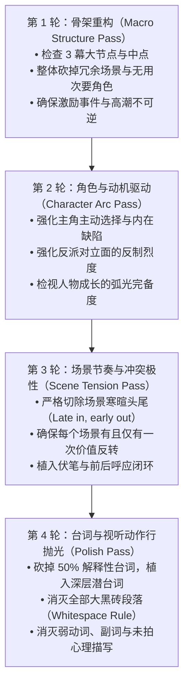

# screenplay-troubleshooting-and-rewrite-doctor

剧本医生系统诊断与重写重构外科手术（常见致命病灶排查清单、被动主角/中段塌陷/机械降神修复、场景头尾切除与四轮重写流水线）。

## 核心法则与剧作力学

### 1. 剧本医生（Script Doctor）七大致命病灶系统排查清单

根据好莱坞资深剧本医生威廉·M·埃克斯（William M. Akers）《你的剧本逊毙了！》（Your Screenplay Sucks!）与罗伯特·麦基的工业诊断理论，剧本审读必须执行无情排查：

1. **慢启动病（The Slow Starter Syndrome）**：
   - **症状**：前 10 页主角在闲逛、起床刷牙、和无关路人扯淡，直到第 15 页甚至第 20 页激励事件才姗姗来迟；
   - **手术刀**：直接撕掉前 10 页！把激励事件直接推到第 3 到第 5 页发生，让读者在第 1 页就感受到世界的悬念与危机。
2. **被动主角综合征（The Passive Protagonist Affliction）**：
   - **症状**：主角只是个旁观者（Observer）或受害者，事件降临在他头上，全靠配角指引或外部巧合推动；
   - **手术刀**：强制赋予主角强烈的“非理性主观渴望”；剥夺所有能够替主角解决问题的配角；每一幕的推进必须是主角主动作出的冒险选择所导致的直接后果。
3. **第二幕泥潭塌陷（The Sagging Second Act）**：
   - **症状**：第 30 页到第 75 页剧情原地打转，主角反复做同样强度的尝试，缺乏阶段性升级；
   - **手术刀**：建立明确的“中点危机（Midpoint Crisis）”——要么是虚假的胜利，要么是毁灭性的挫败，彻底翻转攻守立场并启动不可逆的倒计时时钟（Ticking Clock）。
4. **巧合与机械降神（Coincidence & Deus Ex Machina）**：
   - **症状**：主角在绝境时突然天降神兵、捡到钥匙、反派突发心脏病、暴雨浇灭炸弹；
   - **黄金法则**：巧合只能用来**将主角推入更深的麻烦**（开局激励事件允许巧合），**绝对禁止用巧合解救主角出困境**！主角的解套必须且只能来自其内部技能、牺牲与智斗。
5. **同声传译式千人一面（Uniform Dialogue / Same Voice Syndrome）**：
   - **症状**：遮住角色名字后，所有人的台词听起来都像是同一个三四十岁受过高等教育的编剧在自说自话；
   - **手术刀**：执行“遮名盲测”。为每个角色赋予独特的语速、词汇域、受教育背景口音、以及最重要的一点——迥异的生存哲学与动机。
6. **无转折垃圾场景（Zero-Value Flat Scenes）**：
   - **症状**：场景结束时角色的情绪状态、权力关系或情节信息与场景开始时一模一样（只为了“交代信息”）；
   - **手术刀**：凡是不发生价值极性翻转（+/-）的场景，一律整场删除！
7. **进场太晚，出场太慢（Late In, Early Out）**：
   - **症状**：场景包含了大量繁琐的进门寒暄“嗨，你好吗？”“请坐”，以及离场告别“好的，再见”；
   - **手术刀**：切掉场景头尾！直接在冲突爆发前最后一秒切入场景，在冲突高潮落定的那一刹那立刻切出。

---

### 2. 剧本外科手术四轮重写流水线（Four-Pass Rewrite Pipeline）

不要试图在一次重写中解决所有问题，工业级重写必须遵循分层降维原则：

---

## 工业实操排障与自查反模式表

| 诊断项目 | 危险警报标志 | 外科手术纠正指标 |
| :--- | :--- | :--- |
| **开头抓人度（The Hook）** | 剧本到了第 10 页主角依然没有任何迫切危机 | 第 1 页必须出现强视觉悬念，第 5 页前爆发出发事件 |
| **反派压迫感（Antagonist Weight）** | 反派总是犯低级错误，主角赢得轻而易举 | 反派的智力与战力必须始终比主角高出 30%，主角必须被逼到极限绝境 |
| **伏笔完整性（Plant & Payoff）** | 高潮主角突然拿出从未交代的神秘道具打败敌人 | 任何高潮起决定性作用的物件或技能，必须在第 1 幕自然植入至少 2 次 |
| **台词冗余度（Dialogue Bloat）** | 两个角色站在走廊里互相讲述过去的故事 | 坚决把台词砍半！让角色在做剧烈物理行动的同时惜字如金地对话 |
