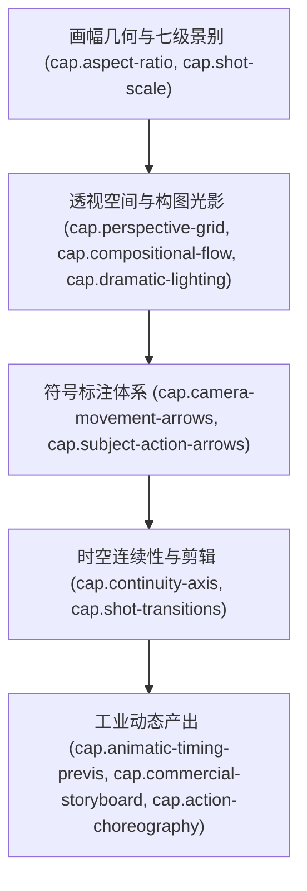

# 《开拍之前：故事板的艺术》（The Art of the Storyboard）书籍架构与工程全貌概览

## 1. 著作元数据与工业定位

- **书名**：《开拍之前：故事板的艺术》（The Art of the Storyboard: Storyboarding for Film, TV, and Animation）
- **作者**：John Hart（约翰·哈特，好莱坞知名资深故事板艺术家、纽约视觉艺术学院与纽约大学电影系资深教授）
- **出版方**：Focal Press（经典影视制作权威出版社）
- **页数**：218页 权威实战案例与行业标准工业图纸规范
- **核心定位**：好莱坞影视工业与全球动画前期制作（Pre-production）的标准化分镜实战手册。本书建立了故事板画师与导演、摄影指导（DP）、剪辑师、特效总监协同作战的**标准化通用视觉语言与符号体系**。它将剧本文字转化为可验证、可预算控制、可直接指导现场拍摄与三维布局（Layout）的工业蓝图。

---

## 2. 核心学术脉络与跨领域价值

在影视与动画工业中，“故事板不是插画，而是一部静态但充满动能的电影预演”：
1. **标准化箭头与符号系统**：彻底消除画师与摄影组之间的沟通歧义，建立白色实心箭头（摄像机运动）、黑色/空心轮廓箭头（角色位移）与双线转动箭头的严格行业标准。
2. **画幅宽高比与视听几何**：深度解析从学院标准 1.33:1（4:3）、宽银幕 1.85:1（16:9）到宽银幕变形镜头 2.39:1（Cinemascope）对构图横向张力与景别心理学的深远影响。
3. **透视与焦距情绪透视法**：揭示一点、两点、三点透视网格在不同焦距镜头（广角拉伸空间 vs 长焦压缩景深）下的戏剧化空间压迫感。
4. **动态故事板（Animatic）工业流水线**：将静态分镜面板导入编辑轨道，匹配对白、临时拟音（Scratch SFX）与节拍器，在真实时间线上测试镜头节奏与信息密度，为长片制作节省数百万美元的废镜头重拍成本。
5. **从 15 秒广告到好莱坞动作大戏**：涵盖极限压缩的商业广告高密节奏，以及多视角动作追逐大戏的分切与冲击力装配。

---

## 3. 12 项 RIA++ 工业级能力卡规划

1. **`cap.storyboard-art.aspect-ratio-framing-geometry`（标准画框宽高比与构图画幅几何学）**
   - 1.33:1, 1.85:1, 2.39:1 画幅特性；安全框（Title Safe & Action Safe）；横向留白与画幅边界张力。
2. **`cap.storyboard-art.shot-scale-visual-hierarchy`（七级景别标尺与镜头心理学）**
   - ELS（大远景）、LS（远景）、MLS/Knee（中远景）、MS（中景）、MCU（中特写）、CU（特写）、ECU（大特写）的几何人体裁切线与情感距离压缩。
3. **`cap.storyboard-art.camera-movement-vector-arrows`（摄影机运动符号学与三维箭头标注规范）**
   - Pan（水平摇）、Tilt（垂直摇）、Dolly/Track（推拉移动车）、Zoom（光学变焦）、Crane/Boom（升降摇臂）的国际标准框内外箭头标注语法。
4. **`cap.storyboard-art.subject-action-directional-arrows`（主体位移、出入画与屏幕矢量指示规范）**
   - 角色移动空心箭头、多面板动作轨迹、从画外入画（Enter Frame）与出画（Exit Frame）标注规则及视线流线闭环。
5. **`cap.storyboard-art.perspective-grid-lens-distortion`（一/二/三点透视网格与广角长焦光学空间压缩）**
   - 视平线（Horizon Line）高度对角色地位的心理定性；一点、两点、三点透视网格构建；广角鱼眼夸张与长焦扁平压缩。
6. **`cap.storyboard-art.compositional-focal-flow`（三分法则、黄金螺旋与视觉流线视线引导）**
   - 九宫格视觉兴趣交叉点；斜角导向线；正反空间与负空间平衡；跨画框注视留白（Looking Room）与引导走位。
7. **`cap.storyboard-art.dramatic-lighting-silhouette`（戏剧性明暗调、黑白灰阶与剪影可读性）**
   - 极速三阶明暗（黑、白、50%灰）；伦勃朗光与高反差低调光（Low-Key）；纯黑纯白剪影瞬间可读性。
8. **`cap.storyboard-art.continuity-axis-screen-direction`（180°动作轴线守恒与屏幕方向连续性）**
   - 假想轴线同侧半圆守恒；左右运动方向连续性；追逐戏同向推进 vs 对峙戏逆向冲撞；视线互锁（Eyeline Locking）。
9. **`cap.storyboard-art.shot-transitions-optical-grammar`（镜头转场与光学剪辑语法）**
   - 硬切（Cut）、淡入淡出（Fade In/Out）、叠化（Dissolve）、划变（Wipe）、匹配剪辑（Match Cut）的故事板面板表达符号。
10. **`cap.storyboard-art.animatic-timing-previs`（动态故事板 Animatic、节拍器与前期预览流水线）**
    - 静态面板时间线化、剪辑节奏（Pacing）、导轨对白配音同步、动作持续帧数计算与三维 Previs 资产前置映射。
11. **`cap.storyboard-art.commercial-15-30s-storyboard`（15秒/30秒商业广告故事板极限压缩叙事）**
    - 3 秒黄金钩子（Hook）、5 秒痛点冲突、15 秒核心解决方案与品牌 Logo 定格收尾的时间分配法则。
12. **`cap.storyboard-art.action-choreography-breakdown`（动作大戏分镜拆解与多面板连续动态编排）**
    - 动作高潮三步曲：蓄力准备势（Anticipation）、打击破坏帧（Impact Frame）、反应击飞与视差缓冲（Reaction & Follow-through）。

---

## 4. 架构映射关系

