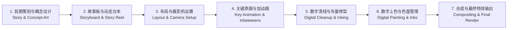

# 数字动画管线与透视速写分析框架与理论模型

## 1. 托尼·怀特无纸数字动画工业生产全景模型（Pencil to Pixels Pipeline）

---

## 2. 透视学几何空间网格四阶体系（Perspective Geometrical Framework）
1. **视平线与心点基准（Horizon Line & Center of Vision）**：
   - 视平线与观察者摄影机镜头的物理高度绝对等高；
   - 心点为视准线垂直穿透画面的正焦点。
2. **一点透视（One-Point / Parallel Perspective）**：
   - 物体主平面与画面平行，仅有一组进深轴线汇聚于单一心点灭点；
   - 应用：长廊、隧道、正对街道，具有强烈的深渊吸入感与戏剧聚焦感。
3. **两点透视（Two-Point / Angular Perspective）**：
   - 物体垂直棱边垂直于地面，水平进深与横向棱边分别汇聚于地平线左右两个灭点（VP-L & VP-R）；
   - 应用：绝大多数室内室外建筑成角观察，空间体积感稳定真实。
4. **三点透视（Three-Point / Oblique Perspective）**：
   - 仰视（仰角虫视 Worm's Eye View，第三灭点在天顶）或俯视（俯角鸟瞰 Bird's Eye View，第三灭点在地底）；
   - 应用：摩天大楼下坠、英雄巍峨俯瞰，具有极限宏大重力压迫。
5. **鱼眼极坐标曲面透视（Curvilinear / Fisheye Perspective）**：
   - 视场角超过 120° 时，所有平直线条弯曲为双曲弧线，呈现四点/五点球极环绕感。

---

## 3. 艺用人体运动学生物杠杆模型（Human Kinesiology Model）
1. **骨盆与胸腔的双向对立扭转（Opposing Torso Masses）**：
   - 胸腔与骨盆是人体最坚硬的两大骨骼体块，正常运动中二者在水平面与冠状面上始终呈现倾斜对抗；
2. **重心支撑面与重力投影（Center of Gravity & Base of Support）**：
   - 人体重心位于下腹部骨盆中心（S2骶椎前方）；
   - 平衡态：重心竖直垂线落在双脚围成的多边形支撑面内；
   - 运动态：重心主动跌出支撑面（不平衡），双腿向前迈步提供新支撑点。

---

## 4. 艾德勒主题阅读（Syntopic Reading）知识工程四层模型
1. **基础阅读（Elementary Reading）**：理解文本字面含义；
2. **检视阅读（Inspectional Reading）**：抓取全书架构与核心目录主线；
3. **分析阅读（Analytical Reading）**：解析核心概念因果链条与论证骨架；
4. **主题阅读（Syntopic Reading）**：融汇跨门类多本著作，建立超验的统一概念术语与工程工具箱。
