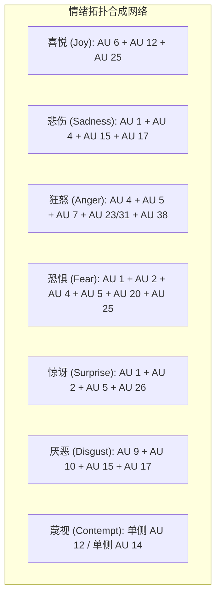

# 《面部表情艺用解剖》（Anatomy of Facial Expression）终极工程全景导读与实战指南

> **“在三维空间中雕刻或绑定人类表情，不是在皮肤表面做橡皮泥捏塑，而是在刚性颅骨的几何轨道上，计算肌纤维矢量牵引下浅层脂肪垫与真皮的欧拉屈曲失稳与正交滑动。”**  
> —— Uldis Zarins & Sandis Kondrats，《Anatomy of Facial Expression》

---

## 目录
1. [宏观架构与解剖学工业化革新](#1-宏观架构与解剖学工业化革新)
2. [头骨几何体块与 10 大刚性解剖标志点](#2-头骨几何体块与-10-大刚性解剖标志点)
3. [正交张力皱纹动力学定律（欧拉屈曲失稳）](#3-正交张力皱纹动力学定律欧拉屈曲失稳)
4. [上部面部肌群：额肌、皱眉肌与眼轮匝肌（AU 1/2/4/5/6/7）](#4-上部面部肌群额肌皱眉肌与眼轮匝肌au-124567)
5. [眼外肌矢量与 1 帧扫视跳跃注视机制（AU 61-64）](#5-眼外肌矢量与-1-帧扫视跳跃注视机制au-61-64)
6. [中面部与鼻肌：上唇鼻翼提肌与鼻唇沟滑移（AU 9/38/39）](#6-中面部与鼻肌上唇鼻翼提肌与鼻唇沟滑移au-93839)
7. [口周动力学：口轮匝肌同心环与红唇白线守恒（AU 18/22/23/24）](#7-口周动力学口轮匝肌同心环与红唇白线守恒au-18222324)
8. [嘴角矢量网络：大颧肌 45° 斜拉 vs 笑肌水平撕扯（AU 11/12/13/20）](#8-嘴角矢量网络大颧肌-45-斜拉-vs-笑肌水平撕扯au-11121320)
9. [下半脸向下张力：降口角肌与颏肌橘皮下巴（AU 15/16/17）](#9-下半脸向下张力降口角肌与颏肌橘皮下巴au-151617)
10. [咀嚼系统与下颌骨 TMJ 双阶段运动学（AU 26/27/31）](#10-咀嚼系统与下颌骨-tmj-双阶段运动学au-262731)
11. [软组织层级：浅深脂肪垫、真骨性支持韧带与老化机制](#11-软组织层级浅深脂肪垫真骨性支持韧带与老化机制)
12. [杜氏真笑 vs 社交假笑：跨越“恐怖谷”的解剖学唯一定量硬门](#12-杜氏真笑-vs-社交假笑跨越恐怖谷的解剖学唯一定量硬门)
13. [人类七大普适核心情绪 FACS 全参数拓扑合成网格](#13-人类七大普适核心情绪-facs-全参数拓扑合成网格)
14. [工程排障手册：十大三维表情绑定与概念原画反模式排查](#14-工程排障手册十大三维表情绑定与概念原画反模式排查)

---

## 1. 宏观架构与解剖学工业化革新

在现代视觉工业（影视特效、写实游戏、二次元动画、数字虚拟人、概念设计）中，面部制作一直被公认为最具挑战的“深水区”。长久以来，艺术家面临着两大知识鸿沟：
1. **传统医用解剖学过于繁冗且静态**：医学教材充斥着大量的拉丁语生僻名词与肌肉切片死板形态，缺乏在活体运动、戏剧张力与透视光影下的形变规律。
2. **心理学 FACS 编码缺乏三维空间几何实现**：保罗·埃克曼创立的面部动作编码系统（FACS）虽然为全球动画工业提供了动作单元（AU）的分类标准，但其纯心理学描述并未解答“当 AU 12 激活时，脸颊顶点应沿何种空间曲面滑移”、“为什么眼轮匝肌收缩会形成特定角度的鱼尾纹”等底层图形学几何问题。

乌尔迪斯·扎林斯（Uldis Zarins）与桑迪斯·孔德拉茨（Sandis Kondrats）创作的《面部表情艺用解剖》（*Anatomy of Facial Expression*），以无与伦比的三维解剖透视图、三维激光扫描与肌肉断层切片，构建了一套将**骨骼刚性几何、肌肉起止点张力、深浅脂肪垫滑移、支持韧带阻隔与正交皱纹发生学**彻底统一的工程体系。

---

## 2. 头骨几何体块与 10 大刚性解剖标志点

### 2.1 骨骼刚性铁律（Cranial Rigidity Axiom）
在面部动力学中，最核心的基础认知是：**除下颌骨通过颞下颌关节（TMJ）可动外，颅骨的其余全部 21 块骨骼在三维空间中形成一个绝对刚性的整体。**
在任何极端夸张的面部表情中，硬质骨骼的间距、曲率和体积永不改变！一切戏剧性形变，都是软组织包裹在骨骼基座上的相对位移。

### 2.2 10 大硬质骨骼标志点三维拓扑定位
1. **眉间点（Glabella）**：额骨正中位于两眉弓之间的平滑微隆骨区。确定面部正中矢状面与前额平面的交汇原点。
2. **额鼻缝 / 鼻根点（Nasion）**：额骨鼻突与鼻骨上缘相接的解剖折凹点。鼻梁骨骼与前额的绝对空间拐点。
3. **眶上缘（Supraorbital Margin）**：额骨界定眼眶上界的圆弧骨嵴。男性骨质圆钝肥厚，伴随显著的眉弓隆起；女性锋利薄脆，前额平坦垂直。
4. **眶下缘（Infraorbital Margin）**：由颧骨体与上颌骨构成的眼眶下边界。是眼轮匝肌下缘滑移与下眼睑饱满度的骨性承托台阶。
5. **颧骨体与颧弓（Zygomatic Bone & Arch）**：面部最宽处的硬质横向骨桥，构成面颊正侧面的空间分水岭。是大颧肌、颧小肌与咬肌的唯一骨性附着原点。
6. **梨状孔（Piriform Aperture）**：鼻腔前部的梨形骨质孔洞。决定鼻软骨基底的宽度与前伸角度。
7. **前鼻棘（Anterior Nasal Spine）**：梨状孔正下方的尖锐骨刺。人中（Philtrum）与上唇中央结缔组织的深层骨性锚点。
8. **犬齿窝（Canine Fossa）**：上颌骨犬齿根部上方的骨性凹坑。提口角肌（AU 13）的骨性起源点。
9. **下颌角（Angle of Mandible）**：下颌体与下颌升支相交的后下转折点。咬肌附着终点与面部下半轮廓转折点。男性夹角趋近于 90°-100°（方下巴），女性为 110°-125°（柔和鹅蛋脸）。
10. **颏隆突与颏结节（Mental Protuberance & Tubercles）**：下颌骨正中下缘的三角形骨质隆起。决定下巴前端平面的宽度与立体凸度。

---

## 3. 正交张力皱纹动力学定律（欧拉屈曲失稳）

### 3.1 物理发生学模型
人体皮肤由富含胶原纤维与弹性纤维的真皮层构成，紧密贴附于浅筋膜与肌肉表面。当皮下表情肌纤维向心收缩缩短时，覆盖其上的皮肤在平行于肌肉收缩轴向的方向受到强烈的压缩应变（Compressive Strain）。

根据连续介质力学中的薄板**欧拉屈曲失稳定律（Euler Buckling Instability）**，当压缩应力超过皮肤临界屈曲阈值时，皮肤为了释放应变能量，必然沿垂直于应力方向向上拱起折叠，从而形成动态皱纹（Dynamic Skin Wrinkles）。

### 3.2 绝对正交几何公式
$$\vec{T}_{\text{wrinkle}} \perp \vec{F}_{\text{muscle}} \quad \Longleftrightarrow \quad \vec{T}_{\text{wrinkle}} \cdot \vec{F}_{\text{muscle}} = 0$$
- **额肌垂直向上收缩（$Y$ 轴）** $\Rightarrow$ 额头产生完全水平横向皱纹（$X$ 轴）；
- **皱眉肌水平向内拉拢（$X$ 轴）** $\Rightarrow$ 眉间印堂产生垂直纵向川字纹（$Y$ 轴）；
- **降眉间肌垂直向下拉拽（$Y$ 轴）** $\Rightarrow$ 鼻根处产生水平横向鼻横纹（$X$ 轴）；
- **眼轮匝肌环形向心收缩（切向切线）** $\Rightarrow$ 外眼角产生放射状向外发散的鱼尾纹（法向放射线）；
- **大颧肌沿 45° 斜向外上收缩** $\Rightarrow$ 面颊产生垂直于拉力线的鼻唇沟深褶；
- **颏肌垂直向上提推（$Y$ 轴）** $\Rightarrow$ 颏唇沟产生水平横向凹折与点阵橘皮纹。

---

## 4. 上部面部肌群：额肌、皱眉肌与眼轮匝肌（AU 1/2/4/5/6/7）

### 4.1 枕额肌额腹（Frontalis - AU 1 & AU 2）
- **解剖走向**：起自帽状腱膜，向下穿过眼轮匝肌止于眉部真皮。
- **内外部三分段解耦**：
  - **AU 1（Inner Brow Raiser）**：仅激活额肌内侧纤维，将内侧眉毛垂直拔起 8-12mm。
  - **AU 2（Outer Brow Raiser）**：仅激活额肌外侧纤维，将外侧眉尾斜向上拉 10-15mm。
  - **AU 1+2 协同**：整条眉毛呈高拱平滑抛物线抬起，额头出现整齐平行的水平横纹（惊异、警觉）。

### 4.2 皱眉肌（Corrugator Supercilii - AU 4）与降眉间肌（Procerus）
- **AU 4（Brow Lowerer）**：起自额骨鼻突，横向止于眉毛中外侧。收缩时将双眉向内、向下死死挤压靠拢，印堂皮肤受横向挤压产生 2-3 条极深的纵向“川字纹”，眉毛内侧呈厚重多肉的隆起结节。
- **降眉间肌**：垂直下拉眉间皮肤，在鼻根点（Nasion）产生横断折痕。

### 4.3 眼轮匝肌（Orbicularis Oculi）双层环形解耦
- **眶部（Pars Orbitalis - AU 6 Cheek Raiser）**：
  - 环绕眼眶骨外周。强力收缩时，将面颊浅层脂肪垫强行向上顶推，下眼睑被迫向上弯成月牙形，并在眼角外侧形成放射状**鱼尾纹（Crow's feet）**。这是杜氏真笑的解剖学灵魂。
- **睑部（Pars Palpebralis - AU 7 Lid Tightener & AU 43 Close）**：
  - 仅覆盖上下眼睑表面。AU 7 轻度收缩使上下眼睑绷紧、睑裂变窄（眯眼审视、怀疑）；AU 43 完全收缩实现自然闭眼。

---

## 5. 眼外肌矢量与 1 帧扫视跳跃注视机制（AU 61-64）

### 5.1 6 块外在眼肌矢量控制
- **上直肌（AU 63 Up）** 与 **下直肌（AU 64 Down）**；
- **内直肌（AU 61/62 Inward）** 与 **外直肌（AU 61/62 Outward）**；
- **双眼会聚聚焦（Vergence）**：近距离注视（读信、看指尖）时，双眼内直肌协同内收，瞳孔朝鼻侧倾斜 5°-15°。

### 5.2 视线转移的生理学铁律：1 帧扫视跳跃（Saccade）
人类视线在转移目标时，绝不是机械马达般的平滑转动，而是以高达 400°-900°/秒的极限角速度，在 **1 至 2 帧（30-50毫秒）** 内爆发性跳跃到位！
- 动画曲线规范：视线属性严禁用平滑 Bezier 缓动曲线；必须使用陡峭的阶跃线（Stepped/Linear），并在落点瞬间赋予 0.5° 的微小惯性回弹。

### 5.3 上眼睑伴随滑移定律（Lid-Follow Mechanics）
上眼睑并非贴在平面上，而是包裹在直径 24mm 的球形眼球表面。
眼球向下旋转时，上眼睑必须跟随滑落：
$$\Delta Y_{\text{lid}} = 0.70 \cdot R \cdot \sin(\theta_{\text{pitch}})$$
当眼球下视 30° 时，上眼睑必须下落约 6mm，遮盖角膜大半部分。若眼睑不下落，角膜上方露出一大片眼白，将瞬间产生僵尸般的病态露白（Graefe's Sign）。

---

## 6. 中面部与鼻肌：上唇鼻翼提肌与鼻唇沟滑移（AU 9/38/39）

### 6.1 上唇鼻翼提肌（AU 9 Nose Wrinkler）
- **起止点**：起自上颌骨额突，向下分为两束止于鼻翼软骨与上唇。
- **解剖功能**：强力收缩时引发 **AU 9（皱鼻）**。鼻翼向上耸起，鼻梁两侧出现斜向交织的密集褶皱，鼻唇沟上端被强力吊起深陷，上唇轻微外翻露牙。这是进化生物学中排出恶臭气味、表达生理与道德**厌恶（Disgust）**的核心原语。

### 6.2 鼻肌横部与翼部（AU 38 & AU 39）
- **AU 38（Nostril Dilator）**：鼻肌翼部收缩，将鼻翼向外侧强力拉扯，鼻孔截面积扩大 50% 以上（狂怒暴吼、深呼吸、惊恐急促喘息）。
- **AU 39（Nostril Compressor）**：鼻肌横部压迫鼻孔收紧（潜水屏息、冷酷审视）。

---

## 7. 口周动力学：口轮匝肌同心环与红唇白线守恒（AU 18/22/23/24）

### 7.1 口轮匝肌同心括约肌架构
- **内环缘部（Pars Marginalis）**：紧贴红唇内沿，负责红唇变薄与微调。收缩产生 **AU 23（紧绷唇）** 与 **AU 24（抿嘴压紧隐入牙槽）**。
- **外环周部（Pars Peripheralis）**：向外辐射融入面颊。
  - **AU 18（Lip Puckerer 噘嘴嘟嘴）**：口裂缩窄，唇体向前凸出 8-12mm，根据体积守恒，嘴唇厚度必然暴增 40%-60%！
  - **AU 22（Lip Funneler 漏斗唇）**：双唇外翻呈喇叭状怒张，露出内黏膜与门牙切缘。

### 7.2 红唇白线（White Line / Vermilion Border）立体滚边
红唇与干燥面部皮肤交界处有一道致密的结缔组织凸起白线。在任何拉伸、咧嘴或嘟嘴形变中，白线必须维持其高反光圆弧滚边，严禁在变形中被拉伸成无厚度的刀刃多边形。

---

## 8. 嘴角矢量网络：大颧肌 45° 斜拉 vs 笑肌水平撕扯（AU 11/12/13/20）

### 8.1 口角轴心（Modiolus）力学枢纽
口角外侧约 1cm 处的致密纤维结节，汇聚了 8 组表情肌的拉力。不同肌群的拉扯构成了完全正交的运动矢量：
- **颧大肌（AU 12）**：沿 **$45^{\circ}$ 夹角斜向外上** 牵引。面颊颧脂肪垫被大幅推挤隆起呈饱满“苹果肌”，鼻唇沟深化（喜悦微笑）。
- **笑肌（AU 20）**：沿 **纯水平横向（$0^{\circ} \sim 5^{\circ}$）** 撕扯。嘴角向后拉扁拉薄，面颊平坦无苹果肌隆起（惊恐、紧张、强颜欢笑）。
- **提口角肌（AU 13）**：垂直向上（$90^{\circ}$）拉起嘴角锐角（得意、狡黠诡笑）。
- **颧小肌（AU 11）**：向上拉动上唇外侧，深化鼻唇沟中部（苦笑、抽泣）。

---

## 9. 下半脸向下张力：降口角肌与颏肌橘皮下巴（AU 15/16/17）

### 9.1 降口角肌（DAO / AU 15 Lip Corner Depressor）
起自下颌骨下缘，向上止于口角轴心。收缩时将嘴角强力向下拉拽呈倒扣弯月形，嘴角外侧形成垂直向下的**木偶纹（Marionette line）**（悲伤、失落）。

### 9.2 降下唇肌（AU 16 Lower Lip Depressor）
起自下颌下缘，止于下唇黏膜。将下唇向外向下翻开，露出整排下门牙（嘲弄撇嘴、痛哭、怒吼）。

### 9.3 颏肌（Mentalis - AU 17 Chin Raiser）反常力学
- **向上顶推**：颏肌起自门齿窝，向下止于下巴皮肤。收缩时**不仅不下拉，反而将下巴圆球形软组织整体向上顶起推高 5-8mm**！
- **倒“U”形下唇**：推起的颏部组织将下唇中央部向上拱起，与降口角肌下拉两侧嘴角共同形成极度悲伤的倒弧形下唇！
- **橘皮下巴（Peau d'orange）**：牵拉真皮在下巴表面产生密集的点状小凹坑。

---

## 10. 咀嚼系统与下颌骨 TMJ 双阶段运动学（AU 26/27/31）

### 10.1 TMJ 复合双阶段运动学
下颌骨张开绝不是单一固定铰链轴的圆规旋转：
1. **阶段 1：纯旋转铰链（张口 $< 20\text{mm}$，AU 26 Jaw Drop）**：髁突在下颌窝内做定轴旋转，下颌轻微下垂，双唇松弛微张（发呆、轻微惊讶、呼吸）。
2. **阶段 2：髁突平移滑行（张口 $> 20\text{mm} \sim 50\text{mm}$，AU 27 Mouth Stretch）**：翼外肌拉动髁突**向前、向下方滑出下颌窝，滑至关节结节下方**！下颌骨整体向前探出并下沉，耳屏前方形成自然的 TMJ 凹陷坑（惊骇尖叫、战场咆哮、大吼）。

### 10.2 咬肌（Masseter - AU 31）与颞肌
咬紧牙关（AU 31）时，咬肌在下颌角前上方暴胀隆起 4-6mm 厚度的坚硬肌腹，使下颌瞬间变宽变方；太阳穴深层颞肌轻微跳动（咬牙切齿、决死拼杀）。

---

## 11. 软组织层级：浅深脂肪垫、真骨性支持韧带与老化机制

- **五层解剖架构**：
  1. 皮肤 $\rightarrow$ 2. 浅层皮下脂肪垫（颧脂肪垫、鼻唇脂肪垫） $\rightarrow$ 3. SMAS 肌肉腱膜系统 $\rightarrow$ 4. 深层间隙与深层脂肪（SOOF、ROOF） $\rightarrow$ 5. 骨膜与骨骼。
- **真骨性支持韧带（Zygomatic & Mandibular Ligaments）**：
  如同坚固的木桩将皮肤深浅层锚定在骨面上。表情肌收缩或重力下垂时，软组织在韧带线上被阻隔堆叠，形成天然的解剖沟槽（法令纹与下颌边缘）。
- **衰老动力学**：韧带松弛，颧脂肪垫沿颧骨斜面向下前方滑脱堆叠在鼻唇沟上方，形成厚重的面颊下垂褶皱。

---

## 12. 杜氏真笑 vs 社交假笑：跨越“恐怖谷”的解剖学唯一定量硬门

| 解剖判别特征 | 杜氏真笑 (Duchenne Smile) | 社交假笑 / 假面笑 (Non-Duchenne) |
| :--- | :--- | :--- |
| **公式闭环** | $\mathbf{AU\ 6} + \mathbf{AU\ 12} + \mathbf{AU\ 25}$ | $\mathbf{AU\ 12} \ \text{或} \ \mathbf{AU\ 20} \quad [\mathbf{AU\ 6 \equiv 0}]$ |
| **眼轮匝肌眶部 (AU 6)** | 强力激活（$0.6 \sim 1.0$） | **完全静止（0.0）** |
| **下眼睑形态** | 被脸颊脂肪推成弯月牙形拱起 | 平直松弛或平切瞳孔下缘 |
| **外眼角鱼尾纹** | $3 \sim 4$ 条放射状动态深折痕 | 零动态皱纹（光滑冷漠） |
| **面颊苹果肌** | 高耸饱满聚拢高光 | 扁平拉宽或无组织向上推挤 |
| **心理感知** | 温暖、真诚、感染力 | 虚伪、尴尬、暗藏杀机、恐怖谷僵尸感 |

---

## 13. 人类七大普适核心情绪 FACS 全参数拓扑合成网格

### 七大情绪全参数矩阵

1. **喜悦（Joy）**：AU 6（眶部推脸+鱼尾纹）+ AU 12（大颧肌斜拉）+ AU 25（微启上唇露牙）。
2. **悲伤（Sadness）**：AU 1（内眉高拔）+ AU 4（内拉下压）形成倒八字眉峰与眉心三角隆起；AU 15（降口角）+ AU 17（推高下巴橘皮球体）形成倒“U”形嘴角。
3. **狂怒（Anger）**：AU 4（双眉死死下锁）+ AU 5（暴睁露白）+ AU 7（下睑紧绷）+ AU 38（鼻孔扩张）+ AU 23/31（抿紧咬牙）或 AU 10+16+26（怒吼露双齿）。
4. **恐惧（Fear）**：AU 1+2（双眉高挑）+ AU 4（强力拉直拉平成水平线）+ AU 5（极度暴睁四面露白）+ AU 20（笑肌水平横向撕扯嘴唇变薄）+ AU 25/26。
5. **惊讶（Surprise）**：AU 1+2（双眉平滑圆拱高挑）+ AU 5（放松大睁）+ AU 26（下颌在重力下自然下垂松弛，双唇无横向张力）。
6. **厌恶（Disgust）**：AU 9（上唇鼻翼提肌强力皱鼻横纹）+ AU 10（提上唇翻门牙）+ AU 15/17（下颌微推嘴角下沉）。
7. **蔑视（Contempt）**：单侧不对称激活：单侧 AU 12（单边嘴角上翘）或单侧 AU 14（单边酒窝收紧），眼神斜睨微抬下巴。

---

## 14. 工程排障手册：十大三维表情绑定与概念原画反模式排查

1. **恐怖谷假笑（Uncanny Zombie Grin）**：
   - *病根*：嘴角上拉但眼部无 AU 6。
   - *排查修复*：强制推高眼下颧脂肪垫，下睑拱起，外眼角绽放 3 条鱼尾纹。
2. **橡皮泥颅骨变形（Play-Doh Skull Distortion）**：
   - *病根*：做大表情时改变眼眶骨骼间距或压扁头骨。
   - *排查修复*：锁定 10 大硬质骨骼标志点，变形仅限于骨骼外侧软组织滑移。
3. **违背正交律的错乱皱纹（Transverse Glabella Error）**：
   - *病根*：在肌肉纤维收缩方向上画平行褶皱。
   - *排查修复*：额头横纹垂直于额肌；眉间川字纹垂直于皱眉肌；鼻横纹垂直于降眉间肌。
4. **恐惧画成惊讶（Fear Mistaken for Surprise）**：
   - *病根*：恐惧时做出高拱圆眉和圆形松弛嘴。
   - *排查修复*：恐惧必须用 AU 4 将眉毛拉成水平直线，并用笑肌 AU 20 向两侧撕扯嘴唇。
5. **悲伤画成愤怒（Grief Mistaken for Anger）**：
   - *病根*：哭泣时眉毛单纯向内下压，丢失内侧额肌 AU 1。
   - *排查修复*：激活 AU 1 形成“内高外低”倒八字，印堂产生三角形泪囊隆起。
6. **下颌定点旋转脱臼（TMJ Single Hinge Dislocation）**：
   - *病根*：大张嘴时下颌做单一圆规旋转，下巴凹陷进脖子。
   - *排查修复*：张嘴超过 20mm 时，髁突向前下方平移滑行 8-12mm。
7. **纸片薄唇体积湮灭（Lip Thinning Volume Collapse）**：
   - *病根*：做嘴型时嘴唇厚度归零。
   - *排查修复*：维持红唇白线（White line）三维滚边，噘嘴时向前隆起厚度增加 40% 以上。
8. **死水漂浮凝视（Dead Eye Stare）**：
   - *病根*：眼球慢悠悠匀速平滑转动，且眼睑不跟随。
   - *排查修复*：视线跳跃压缩至 1 帧（Saccade），下视时上眼睑跟随下落 65%-75%。
9. **气球充气脸颊（Balloon Malar Inflation）**：
   - *病根*：笑时整张脸颊像气球鼓起，法令纹不加深。
   - *排查修复*：引入颧支持韧带阻隔，脂肪隆起的同时鼻唇沟必须向内深陷折叠。
10. **蔑视表情双面对称（Symmetric Contempt Absurdity）**：
    - *病根*：双侧嘴角同时对称翘起。
    - *排查修复*：蔑视必须是单侧非对称微表情，一侧嘴角微扬，另一侧保持中立或下沉。
